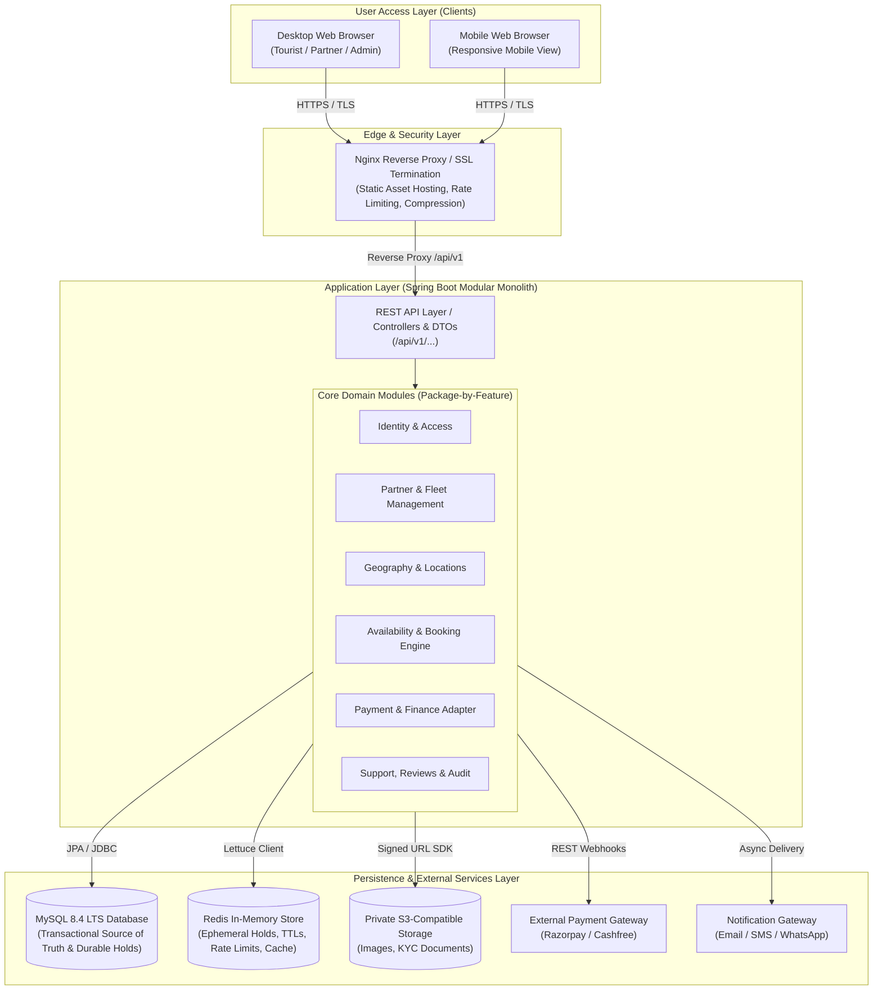

# IslandRide — System Architecture Document
**Document Version:** 1.1.0  
**Phase:** 1 (Requirements & System Design — Post-Review Revisions)  
**Status:** Approved for Implementation  

---

## 1. Architectural Style & Monolith Rationale

IslandRide is architected as a **Modular Monolith** using **Spring Boot 4.1.x (Java 25 LTS)** on the backend and **Angular 22.x (TypeScript)** on the frontend. 

### Why a Modular Monolith over Microservices for MVP?
1. **Transactional Integrity:** Booking reservations, durable temporary hold updates, and financial ledger writes must happen atomically. A monolithic database boundary provides ACID guarantees without the operational fragility of distributed sagas or 2-phase commit protocols.
2. **Operational Simplicity:** Avoids managing distributed service meshes, container orchestrators (Kubernetes), independent CI/CD pipelines, and network RPC overhead.
3. **Domain Evolution:** The business domains (pricing, holds, commissions, handovers) can evolve within one cohesive codebase. Modules are organized with strict boundaries ("Package-by-Feature") so individual domains can be cleanly extracted into standalone services in the future if scale warrants it.

---

## 2. High-Level System Architecture

---

## 3. Technology Stack Alignment

| Tier | Technology Choice | Pinned Version / Standard | Justification |
|---|---|---|---|
| **Frontend** | Angular + TypeScript | Angular 22.x, TypeScript 5.5+ | Enterprise-grade structure, reactive forms, signals, strong typing, clean routing guards. |
| **Backend** | Java LTS + Spring Boot | Java 25 LTS, Spring Boot 4.1.x | High throughput virtual threads, mature security ecosystem, strict transaction control. |
| **Relational DB** | MySQL | 8.4 LTS (InnoDB) | Long-Term Support release, reliable ACID support, transactional row locking. |
| **In-Memory Cache** | Redis | 7.4 / 8.x | Low-latency temporary key-value holds, TTL key expiry, distributed rate limiting. |
| **Migrations** | Flyway | 10.x | Version-controlled, reproducible SQL migration scripts; zero schema drift across environments. |
| **API Contract** | OpenAPI / Swagger | OpenAPI 3.0 (springdoc-openapi) | Auto-generated interactive API docs, strong developer-client contract. |
| **Object Storage** | S3-compatible (MinIO / AWS S3) | AWS SDK v2 for Java | Secure, private bucket storage; time-limited pre-signed download URLs for sensitive PII. |
| **DevOps / Proxy** | Docker & Nginx | Alpine Linux based containers | Predictable multi-stage builds, reverse proxy, Brotli/Gzip compression, SSL termination. |

---

## 4. Cross-Cutting Architectural Patterns

### 4.1 Single SPA with Role-Based Layouts & Backend Authority
The Angular frontend is built as a single Single Page Application (SPA) leveraging route-level code splitting (lazy loading). Four distinct layout components adapt the navigation, header, and sidebar to the user's role:
- `PublicLayoutComponent`: Destination landing pages, search filters, and vehicle galleries.
- `TouristLayoutComponent`: Tourist dashboard, active reservations, voucher downloads, and review center.
- `PartnerLayoutComponent`: Partner operations console, fleet manager, calendar grid, and payout ledgers.
- `AdminLayoutComponent`: Platform governance console, partner verification queue, dispute arbitration, and audit logs.

> **Security Note:** Route guards and lazy loading provide presentation isolation and performance optimization only. The backend API is the **sole security authority** and enforces authorization checks on every request.

### 4.2 Decoupled Payment Gateway Adapter Pattern
The payment domain uses the **Adapter Pattern** (`PaymentGatewayAdapter` interface). Concrete implementations (e.g. `RazorpayPaymentAdapter`, `MockPaymentAdapter`) encapsulate gateway-specific SDKs. Changing the gateway requires implementing the interface without modifying booking or ledger domain logic.

### 4.3 Centralized Error Handling & Problem Details
All API controllers inherit global exception interception via `@ControllerAdvice`. Errors are formatted per **RFC 7807 (Problem Details for HTTP APIs)**, ensuring frontend components receive consistent error messages, field validation maps, and correlation IDs.
