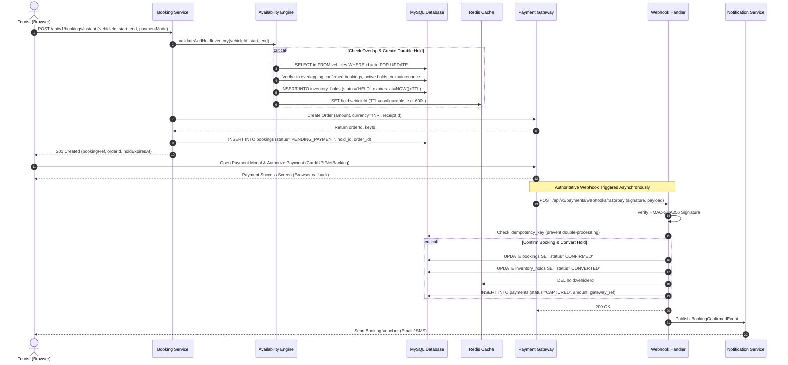
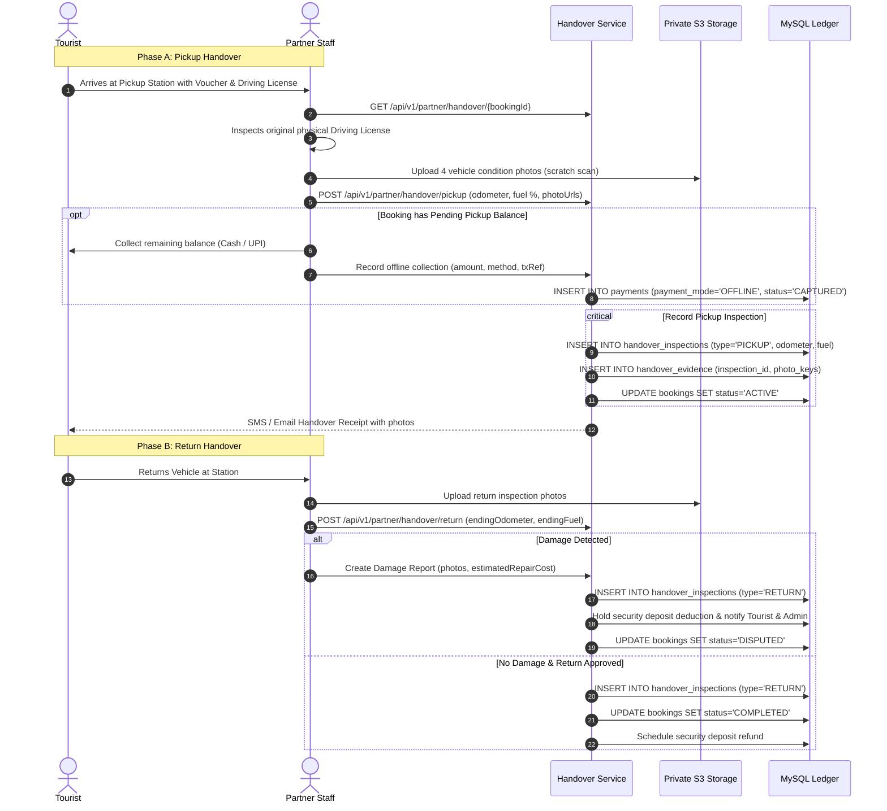

# IslandRide — System Workflows & Sequence Diagrams
**Document Version:** 1.1.0  
**Phase:** 1 (Requirements & System Design — Post-Review Revisions)  
**Status:** Approved for Implementation  

---

## 1. Instant Booking & Online Payment Workflow

This workflow illustrates an instant-confirmation booking, including durable MySQL inventory holds, Redis ephemeral coordination, gateway order creation, and signed webhook verification.



---

## 2. Vehicle Handover (Pickup & Return) Workflow

This workflow captures structured digital proof of vehicle condition, fuel levels, odometer readings, and balance settlement via `handover_inspections` and `handover_evidence` records.



---

## 3. Asynchronous Refund & Gateway Reconciliation Workflow

```mermaid
sequenceDiagram
    autonumber
    actor Actor as Tourist / Admin
    participant RefundService as Refund Service
    participant DB as MySQL Database
    participant Gateway as Payment Gateway
    participant ReconcileJob as Nightly Reconciliation Cron

    Actor->>RefundService: Request Cancellation / Refund
    RefundService->>DB: INSERT INTO refunds (status='PENDING', idempotency_key=UUID)
    
    RefundService->>Gateway: POST /v1/refunds (paymentId, amount, idempotencyKey)
    alt Gateway Responds Success Immediately
        Gateway-->>RefundService: 200 OK (gateway_refund_id, status='processed')
        RefundService->>DB: UPDATE refunds SET status='SUCCESS', gateway_refund_id=...
    else Gateway Timeout / Transient Network Error
        Gateway-->>RefundService: 504 Gateway Timeout / Network Fail
        RefundService->>DB: UPDATE refunds SET status='RETRY_SCHEDULED', retry_count=retry_count+1
        Note over RefundService: Exponential backoff worker retries with same idempotency key
    end

    Note over ReconcileJob,Gateway: Scheduled Reconciliation Worker
    ReconcileJob->>Gateway: GET /v1/refunds/reconciliation (batch_date)
    Gateway-->>ReconcileJob: Return all processed refund records
    ReconcileJob->>DB: UPDATE refunds SET status='RECONCILED', reconciled_at=NOW()
```
