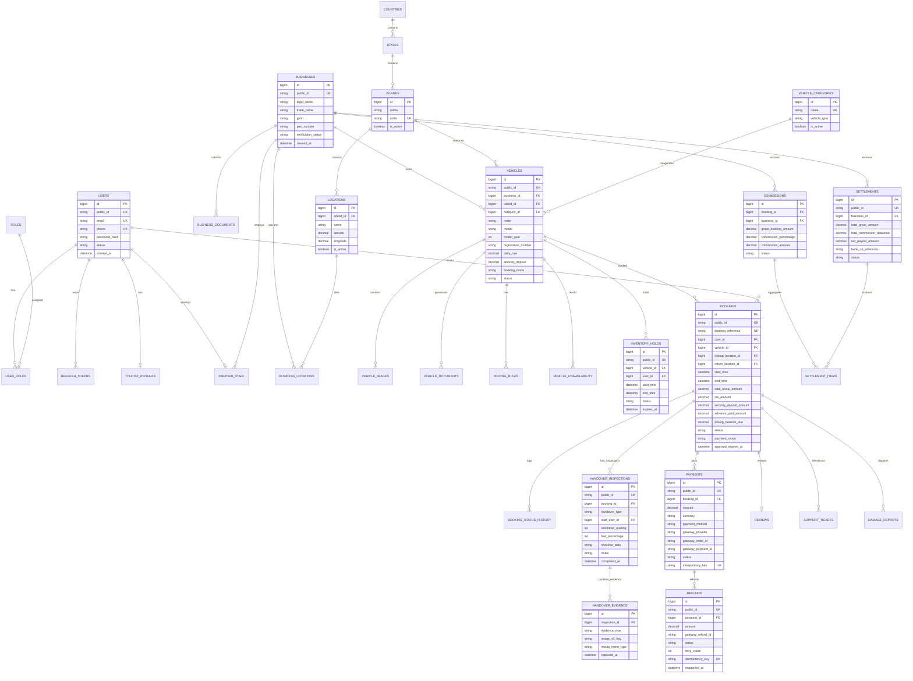

# IslandRide — Entity-Relationship Diagram (ERD)
**Document Version:** 1.1.0  
**Phase:** 1 (Requirements & System Design — Post-Review Revisions)  
**Status:** Approved for Implementation  

---

## 1. Updated Logical Relational Schema

### Key Model Refinements for MVP
1. **Single Vehicle per Booking (MVP Boundary):** The ambiguous `booking_items` table has been removed. Each `bookings` record directly references exactly one `vehicles` record (`vehicle_id BIGINT UNSIGNED NOT NULL`). Multi-vehicle group reservations are deferred to post-MVP.
2. **Durable Inventory Holds:** `inventory_holds` is a fully normalized, durable MySQL entity ensuring that active holds are never lost if Redis restarts.
3. **Structured Handover & Evidence Hierarchy:** Handover is separated into `handover_inspections` (capturing pickup or return inspection metadata, odometer, fuel, staff user, and condition notes) and a child entity `handover_evidence` (capturing individual photographic proofs, evidence angles, and upload coordinates).
4. **Resilient Refund & Ledger Model:** `refunds` contains retry counters, gateway reconciliation IDs, and idempotency keys to handle asynchronous payment gateway failures cleanly.

