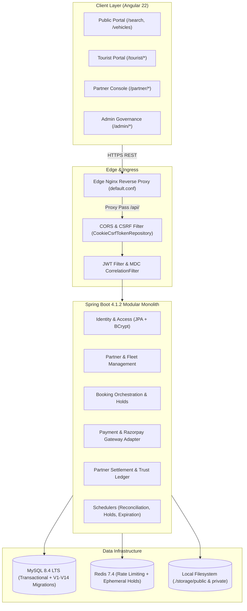

# IslandRide — Phase 7: Production Readiness Audit Report

**Date:** 2026-11-13  
**Auditor:** Antigravity Autonomous Security & Architecture Review  
**Git Baseline Commit:** `cce41b3`  
**Branch:** `main`  
**Repository:** `D:\Rental app _ Andaman nicobar`  
**Verification Status:** Baseline preserved (strictly read-only audit; zero source, config, or schema files modified)  

---

## 1. Executive Summary

IslandRide has successfully implemented and verified the foundational business domains across Phases 1 through 6D, including multi-tenant RBAC, vehicle inventory management, durable inventory holds, booking orchestration, partner financial settlement ledgers, and an Andaman Coastal design system.

However, a rigorous production-readiness audit reveals that **the repository is NOT yet ready for immediate public production deployment**. While the core domain logic, database schemas (V1–V14), and UI components are robust and well-structured, several **critical infrastructure, payment gateway, security, and notification gaps** must be remediated prior to go-live:

1. **Payment Gateway Disconnect:** The frontend tourist checkout page currently only supports simulated mock payment events and lacks the real Razorpay Checkout modal SDK (`checkout.js`). In addition, `application-prod.yml` lacks configuration properties for the payment gateway, leaving it defaulting to mock mode in production.
2. **Email Delivery is a Stub:** The production `SmtpEmailService` contains no JavaMailSender or SMTP transport; it merely writes log entries to the console. Users cannot receive password reset tokens or email confirmations.
3. **Production Redis Configuration Omission:** `application-prod.yml` omits `spring.data.redis` settings, causing production deployments to ignore `REDIS_HOST`, `REDIS_PORT`, and `REDIS_PASSWORD` and fall back to unauthenticated `localhost:6379`.
4. **Authentication Vulnerabilities:** Login, registration, and password reset endpoints lack rate limiting and brute-force lockout mechanisms. Furthermore, Spring Boot Actuator exposes JVM metrics and Prometheus telemetry without authentication.
5. **Container & Storage Deficiencies:** The frontend Dockerfile cannot be built due to contradictory context paths, and media storage relies entirely on the local ephemeral filesystem without S3/MinIO object storage support.
6. **Scalability Bottlenecks:** Admin financial overviews, user management, and escalation handlers load entire database tables into JVM heap memory via unbounded `findAll().stream()` operations.

**Overall Readiness Status:** **CONDITIONAL RED (NOT PRODUCTION READY — Remediations Required)**

---

## 2. Current Architecture Assessment



### Architectural Strengths
- **Modular Monolith Discipline:** Package boundaries between `booking`, `inventory`, `partner`, `paymentfinance`, and `identityaccess` are strictly maintained and verified by ArchUnit tests.
- **Stateless Authentication & Host Cookies:** Access tokens remain strictly in-memory; refresh tokens utilize HTTP-only `__Host-refresh_token` cookies with `SameSite=Strict`.
- **Database Schema Quality:** Flyway migrations V1–V14 provide comprehensive foreign key constraints, optimistic concurrency locking (`version`), and interval-overlap indexes (`idx_bookings_availability`).
- **Cryptographic Webhook Verification:** Gateway webhooks read verbatim raw payload bytes before JSON parsing to preserve byte-for-byte HMAC-SHA256 signature integrity.

---

## 3. Production-Readiness Checklist

| Category | Inspection Item | Status | Verified Finding / Gap |
| :--- | :--- | :--- | :--- |
| **Frontend** | Angular Standalone Components & Routing | PASS | Lazy-loaded routes, role guards, and coastal design tokens verified. |
| **Frontend** | Environment Build Replacements | **FAIL** | `angular.json` lacks `fileReplacements` for `environment.prod.ts`. |
| **Frontend** | Production Razorpay Checkout Modal | **FAIL** | Only mock simulator buttons implemented; `checkout.js` absent. |
| **Frontend** | Global Error Handling & Notifications | **WARN** | No global `ErrorHandler` or unified toast service configured. |
| **Backend** | Spring Boot & Java 25 Runtime | PASS | Java 25 LTS with virtual threads / graceful shutdown enabled. |
| **Backend** | RFC 7807 Exception Responses | PASS | `GlobalExceptionHandler` formats structured error payloads with MDC correlation IDs. |
| **Backend** | Production Gateway Configuration | **FAIL** | `application-prod.yml` omits `islandride.payment` property tree. |
| **Security** | In-Memory Token & CSRF Architecture | PASS | Double-submit CSRF tokens and in-memory JWT storage verified. |
| **Security** | Brute-Force & Credential Stuffing Defense | **FAIL** | No rate limiting or account lockouts on `/api/v1/auth/login`. |
| **Security** | Actuator & Swagger Production Hardening | **FAIL** | `/actuator/**` and Swagger UI exposed without authentication. |
| **Database** | Migrations & Index Integrity (V1–V14) | PASS | Indexes on foreign keys, statuses, and booking ranges verified. |
| **Database** | Automated Backup & Disaster Recovery | **FAIL** | No backup automation, dump scripts, or point-in-time recovery plans. |
| **Storage** | Object Storage for Media & Documents | **FAIL** | Stores uploads on local ephemeral disk (`./storage`); no S3/MinIO provider. |
| **Deployment** | Dockerfile Context & Reproducibility | **FAIL** | `frontend.Dockerfile` copy paths are incompatible with repository root. |
| **Deployment** | Multi-Instance Distributed Schedulers | **WARN** | `@Scheduled` tasks lack ShedLock or Redis distributed locks. |
| **Monitoring** | Structured Logging & Telemetry | **FAIL** | Plain text console logs without `logback-spring.xml` or JSON encoder. |
| **Email/SMS** | Transactional Messaging Delivery | **FAIL** | `SmtpEmailService` is a console logging stub; no real email delivery. |

---

## 4. Detailed Audit Findings by Severity

### Critical Severity Findings

#### [FINDING-CRIT-01] Production Profile Omits Payment Gateway Configuration, Defaulting to Mock Mode
- **Finding ID:** `FINDING-CRIT-01`
- **Severity:** `CRITICAL`
- **Affected File/Module:** `backend/src/main/resources/application-prod.yml`, `backend/src/main/java/com/islandride/paymentfinance/gateway/PaymentGatewayProperties.java`
- **Evidence:** `application-prod.yml` lines 1–59 contains configurations for datasource, hikari, flyway, security, mail, storage, and ratelimit, but **completely omits** `islandride.payment`. In `PaymentGatewayProperties.java` lines 10–13, `provider` defaults to `"mock"` and `liveEnabled` defaults to `false`. Furthermore, `.env.example` documents `PAYMENT_GATEWAY_PROVIDER` and `RAZORPAY_KEY_ID`, which do not match Spring's relaxed prefix binding for `islandride.payment.*`.
- **Business Impact:** When deployed to production, real payments cannot be processed. Tourists cannot pay with live instruments, and if mock mode remains active, users could reserve vehicles for free without paying real money.
- **Recommended Solution:** Add explicit payment configuration to `application-prod.yml`:
  ```yaml
  islandride:
    payment:
      provider: ${ISLANDRIDE_PAYMENT_PROVIDER:razorpay}
      live-enabled: ${ISLANDRIDE_PAYMENT_LIVE_ENABLED:true}
      order-expiry-minutes: 15
      razorpay:
        base-url: ${RAZORPAY_BASE_URL:https://api.razorpay.com/v1}
        key-id: ${RAZORPAY_KEY_ID}
        key-secret: ${RAZORPAY_KEY_SECRET}
        webhook-secret: ${RAZORPAY_WEBHOOK_SECRET}
  ```

---

#### [FINDING-CRIT-02] Real Razorpay Checkout Modal Missing from Frontend Tourist Checkout
- **Finding ID:** `FINDING-CRIT-02`
- **Severity:** `CRITICAL`
- **Affected File/Module:** `frontend/src/index.html`, `frontend/src/app/features/tourist/checkout/tourist-checkout.component.ts`
- **Evidence:** `frontend/src/index.html` lines 1–16 does not load the Razorpay checkout script (`https://checkout.razorpay.com/v1/checkout.js`). `tourist-checkout.component.ts` lines 490–570 contains only mock testing methods (`simulatePaymentSuccess`, `simulateWebhookCapture`, `simulateFailure`). When `activeCheckoutOrder()` is received, the template displays test simulation action cards rather than invoking `new (window as any).Razorpay(options).open()`.
- **Business Impact:** Real end-users in production cannot complete checkout with UPI, NetBanking, or debit/credit cards. The customer checkout journey is blocked at the final payment step.
- **Recommended Solution:** 
  1. Add Razorpay JS SDK loading to `index.html` or dynamically load it upon entering `/tourist/checkout`.
  2. Implement real Razorpay checkout initialization:
     ```typescript
     const rzp = new (window as any).Razorpay({
       key: order.gatewayKeyId,
       amount: order.amountPaise,
       currency: 'INR',
       name: 'IslandRide Andaman',
       order_id: order.gatewayOrderId,
       handler: (response: any) => this.verifyLivePayment(response)
     });
     rzp.open();
     ```
  3. Gate the mock test simulation buttons strictly behind `!environment.production`.

---

#### [FINDING-CRIT-03] SMTP Email Service is a Console Logging Stub (No Email Delivery)
- **Finding ID:** `FINDING-CRIT-03`
- **Severity:** `CRITICAL`
- **Affected File/Module:** `backend/src/main/java/com/islandride/identityaccess/service/SmtpEmailService.java`
- **Evidence:** Lines 24–38 of `SmtpEmailService.java`:
  ```java
  @Override
  public void sendPasswordResetEmail(String toEmail, String resetToken) {
      log.info("Production SMTP Relay [host={}]: Dispatched password reset message from {} to masked recipient...", smtpHost, fromEmail);
  }
  ```
  The class does not inject `JavaMailSender`, has no MIME message constructor, and connects to no external SMTP server.
- **Business Impact:** Users who click "Forgot Password" never receive a reset email. Account lockouts and password resets cannot be completed in production. Booking confirmation receipts cannot be delivered.
- **Recommended Solution:** Replace the stub with a real `JavaMailSender` implementation utilizing `spring-boot-starter-mail` and Thymeleaf HTML templates for transactional emails (Password Reset, Booking Confirmation, Refund Notification).

---

#### [FINDING-CRIT-04] Production Redis Configuration Missing in `application-prod.yml`
- **Finding ID:** `FINDING-CRIT-04`
- **Severity:** `CRITICAL`
- **Affected File/Module:** `backend/src/main/resources/application-prod.yml`
- **Evidence:** `application-prod.yml` lines 1–59 defines datasource, hikari, and flyway, but has no `spring.data.redis` block. Only `application-local.yml` lines 37–42 specifies Redis connection settings. In production (`SPRING_PROFILES_ACTIVE=prod`), Spring Boot defaults to `localhost:6379` without authentication, ignoring `REDIS_HOST`, `REDIS_PORT`, and `REDIS_PASSWORD` environment variables.
- **Business Impact:** In any cloud or containerized deployment where Redis runs on a separate container or managed host (AWS ElastiCache, Azure Cache for Redis), the backend will fail to connect to Redis, causing rate limiting and cache lookups to crash or hang.
- **Recommended Solution:** Add Redis configuration to `application-prod.yml`:
  ```yaml
  spring:
    data:
      redis:
        host: ${REDIS_HOST:redis}
        port: ${REDIS_PORT:6379}
        password: ${REDIS_PASSWORD}
        ssl:
          enabled: ${REDIS_SSL_ENABLED:false}
        timeout: 2000ms
  ```

---

### High Severity Findings

#### [FINDING-HIGH-01] Missing Brute-Force Protection and Rate Limiting on Authentication APIs
- **Finding ID:** `FINDING-HIGH-01`
- **Severity:** `HIGH`
- **Affected File/Module:** `backend/src/main/java/com/islandride/identityaccess/api/AuthController.java`, `service/AuthService.java`
- **Evidence:** `AuthService.java` lines 98–105 checks passwords via `passwordEncoder.matches(request.password(), user.getPasswordHash())`. If invalid, it throws `BadCredentialsException`. There is no tracking of failed attempts, no lockout threshold after 5 failed attempts, and `RateLimitService` is not applied to `/api/v1/auth/login`, `/api/v1/auth/register`, or `/api/v1/auth/forgot-password`.
- **Business Impact:** Automated botnets can perform high-speed credential stuffing and password guessing against tourists, fleet partners, and administrators.
- **Recommended Solution:** Enforce Redis-backed IP and username rate limiting (e.g. 5 attempts per 15 minutes) and implement an account lockout policy (`UserStatus.LOCKED`) after 5 consecutive failed authentications.

---

#### [FINDING-HIGH-02] Spring Boot Actuator Telemetry and Prometheus Endpoints Exposed Publicly
- **Finding ID:** `FINDING-HIGH-02`
- **Severity:** `HIGH`
- **Affected File/Module:** `backend/src/main/java/com/islandride/core/config/SecurityConfig.java`, `application.yml`
- **Evidence:** `application.yml` lines 26–36 includes `health,info,metrics,prometheus`. `SecurityConfig.java` lines 86–91 explicitly configures `.requestMatchers("/actuator/**").permitAll()`.
- **Business Impact:** Any anonymous user on the public internet can scrape `/actuator/metrics` and `/actuator/prometheus`, exposing heap memory utilization, thread dumps, classloader statistics, active HTTP request rates, and internal endpoint paths.
- **Recommended Solution:** In `SecurityConfig.java`, restrict `/actuator/**` endpoints (excluding `/actuator/health`) to `ROLE_SUPER_ADMIN` or bind Actuator to an internal management port (`management.server.port=8081`) inaccessible from public ingress.

---

#### [FINDING-HIGH-03] Frontend Dockerfile Context Inconsistency
- **Finding ID:** `FINDING-HIGH-03`
- **Severity:** `HIGH`
- **Affected File/Module:** `infrastructure/docker/frontend.Dockerfile`
- **Evidence:** `frontend.Dockerfile` lines 8–16 contains:
  ```dockerfile
  COPY package*.json ./
  ...
  COPY ./infrastructure/nginx/default.conf /etc/nginx/conf.d/default.conf
  ```
  If built with context `frontend/`, `./infrastructure/nginx/default.conf` does not exist. If built with context `.`, `COPY package*.json ./` fails because `package.json` is located in `frontend/package.json`.
- **Business Impact:** Automated Docker container image builds fail during container packaging. The frontend container cannot be deployed to production Kubernetes, ECS, or Docker hosts.
- **Recommended Solution:** Standardize build context to the repository root:
  ```dockerfile
  FROM node:24-alpine AS build
  WORKDIR /app
  COPY frontend/package*.json ./
  RUN npm ci --prefer-offline
  COPY frontend/ ./
  RUN npm run build -- --configuration=production

  FROM nginx:1.27-alpine
  COPY --from=build /app/dist/islandride-frontend/browser /usr/share/nginx/html
  COPY infrastructure/nginx/default.conf /etc/nginx/conf.d/default.conf
  EXPOSE 80
  CMD ["nginx", "-g", "daemon off;"]
  ```

---

#### [FINDING-HIGH-04] Media Storage Uses Ephemeral Local Filesystem Instead of Cloud Object Storage
- **Finding ID:** `FINDING-HIGH-04`
- **Severity:** `HIGH`
- **Affected File/Module:** `backend/src/main/java/com/islandride/core/storage/LocalMediaStorageService.java`
- **Evidence:** `MediaStorageService` only has a single implementation: `LocalMediaStorageService.java`, which writes vehicle photos and driver documents to local directories (`./storage/public` and `./storage/private`). No AWS S3, Cloudflare R2, or MinIO client exists in the codebase.
- **Business Impact:** In scalable container environments (Kubernetes pods or Docker swarm replicas), vehicle photos uploaded to one container are unavailable to others. When containers restart or autoscale, all stored files are permanently destroyed unless mounted to persistent network volumes.
- **Recommended Solution:** Implement an `S3MediaStorageService` utilizing the AWS SDK for Java (v2) or S3-compatible client (MinIO/R2) gated behind `islandride.storage.provider=s3`.

---

#### [FINDING-HIGH-05] Unbounded `findAll().stream()` In-Memory Heap Processing in Finance & Admin Modules
- **Finding ID:** `FINDING-HIGH-05`
- **Severity:** `HIGH`
- **Affected File/Module:** `AdminFinanceOverviewService.java`, `AdminManagementService.java`, `PaymentOrchestrationService.java`, `RefundOrchestrationService.java`
- **Evidence:** 
  - `AdminFinanceOverviewService.java` lines 60–95 calls `paymentRepository.findAll().stream()`, `offlineCollectionRepository.findAll().stream()`, `commissionRepository.findAll().stream()`, and `refundRepository.findAll().stream()`.
  - `AdminManagementService.java` line 37 calls `userRepository.findAll().stream()`.
  - `PaymentOrchestrationService.java` line 639 and `RefundOrchestrationService.java` line 366 call `userRepository.findAll().stream()` to find administrative users to notify.
- **Business Impact:** Under realistic production loads (10,000+ bookings and payments), loading entire entity collections into JVM memory causes severe garbage collection pauses, high CPU load, and `OutOfMemoryError` crashes.
- **Recommended Solution:** Replace in-memory stream filtering with database-level aggregate SQL queries (e.g. `SELECT COALESCE(SUM(p.amount), 0) FROM Payment p WHERE ...`) and add targeted repository queries (e.g. `userRepository.findByRoleNameIn(...)`).

---

#### [FINDING-HIGH-06] Total Absence of Automated Database Backup & Disaster Recovery Automation
- **Finding ID:** `FINDING-HIGH-06`
- **Severity:** `HIGH`
- **Affected File/Module:** `scripts/`, `docker-compose.yml`, `infrastructure/`
- **Evidence:** The repository contains no database dump scripts, backup verification tools, or point-in-time recovery configurations. Only local development startup scripts (`start-islandride.ps1`, `setup-dev.ps1`) exist.
- **Business Impact:** In the event of disk corruption, accidental data deletion, or ransomware attack on the database host, business data (bookings, payments, vehicle verification records) cannot be recovered.
- **Recommended Solution:** Provide automated daily mysqldump / physical backup scripts with gzip compression, retention rotation (7 daily, 4 weekly), and offsite upload to secure encrypted cloud storage.

---

### Medium Severity Findings

#### [FINDING-MED-01] Frontend Production Build Lacks `fileReplacements` in `angular.json`
- **Finding ID:** `FINDING-MED-01`
- **Severity:** `MEDIUM`
- **Affected File/Module:** `frontend/angular.json`
- **Evidence:** `angular.json` lines 34–66 configures the `production` build target but omits `fileReplacements`. During `ng build`, `environment.prod.ts` is never substituted for `environment.ts`. While current services reference relative `/api/v1` strings, any future or existing component reading `environment.apiBaseUrl` will incorrectly use `http://localhost:8080/api/v1` in production.
- **Recommended Solution:** Add the standard `fileReplacements` block under `architect.build.configurations.production` in `angular.json`.

---

#### [FINDING-MED-02] Swagger UI and OpenAPI Documentation Exposed in Production
- **Finding ID:** `FINDING-MED-02`
- **Severity:** `MEDIUM`
- **Affected File/Module:** `backend/src/main/java/com/islandride/core/config/SecurityConfig.java`, `application-prod.yml`
- **Evidence:** `/swagger-ui/**`, `/swagger-ui.html`, and `/v3/api-docs/**` are configured as `permitAll()` in `SecurityConfig.java` and are not disabled in `application-prod.yml`.
- **Recommended Solution:** Disable Swagger UI in production by adding `springdoc.swagger-ui.enabled=false` and `springdoc.api-docs.enabled=false` in `application-prod.yml`, or require `ROLE_SUPER_ADMIN`.

---

#### [FINDING-MED-03] Missing ShedLock / Distributed Locking on Scheduled Background Tasks
- **Finding ID:** `FINDING-MED-03`
- **Severity:** `MEDIUM`
- **Affected File/Module:** `HoldExpirationScheduler.java`, `BookingExpirationScheduler.java`, `PaymentReconciliationScheduler.java`, `RefundRetryScheduler.java`
- **Evidence:** All schedulers use Spring's `@Scheduled` annotation without distributed coordination.
- **Recommended Solution:** Integrate ShedLock with Redis provider (`@EnableSchedulerLock` / `@SchedulerLock`) so that only one pod executes any scheduled task at a time in multi-instance deployments.

---

#### [FINDING-MED-04] Partner Registration Hardcodes Commission Rate (4.00%)
- **Finding ID:** `FINDING-MED-04`
- **Severity:** `MEDIUM`
- **Affected File/Module:** `backend/src/main/java/com/islandride/partner/service/PartnerService.java`
- **Evidence:** Line 81 hardcodes `business.setCommissionRate(new BigDecimal("4.00"));` instead of injecting `${islandride.booking.default-commission-rate:4.0}`.
- **Recommended Solution:** Inject the configurable platform default commission rate into `PartnerService`.

---

#### [FINDING-MED-05] Missing In-App Notifications API & UI Dropdown
- **Finding ID:** `FINDING-MED-05`
- **Severity:** `MEDIUM`
- **Affected File/Module:** `backend/src/main/java/com/islandride/notifications/`, `frontend/src/app/layouts/`
- **Evidence:** `NotificationDispatchService` saves notification records, but there is no `NotificationController` and no UI notification bell in the frontend layouts.
- **Recommended Solution:** Create `GET /api/v1/notifications` and `PATCH /api/v1/notifications/{id}/read` endpoints and add an unread notifications indicator in the top navbar.

---

#### [FINDING-MED-06] Support Ticket and Review Modules Incomplete
- **Finding ID:** `FINDING-MED-06`
- **Severity:** `MEDIUM`
- **Affected File/Module:** `backend/src/main/java/com/islandride/support/`, `com/islandride/reviews/`
- **Evidence:** Both packages contain entities and JPA repositories, but have no services, controllers, or frontend UI screens.
- **Recommended Solution:** Mark these modules as post-launch (Phase 8) or implement basic REST APIs and UI views prior to general public release.

---

#### [FINDING-MED-07] Rate Limiting Not Applied to Catalog Search & Public APIs
- **Finding ID:** `FINDING-MED-07`
- **Severity:** `MEDIUM`
- **Affected File/Module:** `backend/src/main/java/com/islandride/core/security/RateLimitService.java`
- **Evidence:** `RateLimitService` is only called for file uploads. Endpoints `/api/v1/vehicles`, `/api/v1/public/bookings/quote`, and `/api/v1/locations/**` have no rate limiting.
- **Recommended Solution:** Apply IP-based rate limiting via a Spring HandlerInterceptor or Gateway filter (e.g. 100 requests per minute per IP for catalog browsing).

---

#### [FINDING-MED-08] Missing Structured JSON Logging in Production
- **Finding ID:** `FINDING-MED-08`
- **Severity:** `MEDIUM`
- **Affected File/Module:** `backend/src/main/resources/`
- **Evidence:** No `logback-spring.xml` exists. Production logs output unstructured plain text without explicit `%X{correlationId}` pattern formatting.
- **Recommended Solution:** Add `logback-spring.xml` configuring `logstash-logback-encoder` for JSON output in the `prod` profile.

---

### Low Severity Findings

#### [FINDING-LOW-01] Frontend Component Testing Gaps
- **Finding ID:** `FINDING-LOW-01`
- **Severity:** `LOW`
- **Affected File/Module:** `frontend/src/app/features/tourist/checkout/`, `tourist/bookings/`
- **Evidence:** 0 unit test specs exist for `tourist-checkout.component.ts`, `tourist-bookings.component.ts`, `tourist-booking-detail.component.ts`, `home.component.ts`, or `role.guard.ts`.
- **Recommended Solution:** Add Jasmine/Karma unit test specs for checkout state transitions and booking detail views.

#### [FINDING-LOW-02] Absence of Load & Concurrency Testing Scripts
- **Finding ID:** `FINDING-LOW-02`
- **Severity:** `LOW`
- **Affected File/Module:** `scripts/`
- **Evidence:** No k6 or JMeter test scenarios exist to simulate concurrent booking hold acquisition under peak seasonal traffic.
- **Recommended Solution:** Provide a k6 load test script simulating 100 concurrent users acquiring holds on high-demand vehicle categories.

---

## 5. Missing Features & Incomplete Integrations

```
┌─────────────────────────────────────────────────────────────────────────────┐
│                       ISLANDRIDE FEATURE MATURITY MATRIX                     │
├────────────────────────┬─────────────┬─────────────┬────────────────────────┤
│ Feature Domain         │ Backend API │ Frontend UI │ Production Readiness   │
├────────────────────────┼─────────────┼─────────────┼────────────────────────┤
│ Authentication & RBAC  │ Complete    │ Complete    │ Missing Rate Limiter   │
│ Vehicle Inventory      │ Complete    │ Complete    │ Complete               │
│ Booking & Holds        │ Complete    │ Complete    │ Complete               │
│ Real Payment Gateway   │ Adapter OK  │ STUB ONLY   │ BLOCKED (Mock Only)    │
│ Webhook Signature HMAC │ Complete    │ Complete    │ Complete               │
│ Partner Financials     │ Complete    │ Complete    │ Complete               │
│ Email Notifications    │ STUB ONLY   │ N/A         │ BLOCKED (No SMTP)      │
│ In-App Notifications   │ DB Only     │ Missing     │ Incomplete             │
│ Support Tickets        │ Entity Only │ Missing     │ Incomplete             │
│ Vehicle Reviews        │ Entity Only │ Missing     │ Incomplete             │
│ Object Storage (S3)    │ Local Only  │ Complete    │ Incomplete (Local)     │
└────────────────────────┴─────────────┴─────────────┴────────────────────────┘
```

---

## 6. Security Risks & Recommendations

1. **Authentication Brute-Force & Credential Stuffing:** Implement Redis-based rate limiting on `/api/v1/auth/login` (5 attempts/15 min) and lock accounts after repeated failures.
2. **Telemetry Information Disclosure:** Restrict `/actuator/**` (except `/actuator/health`) to `ROLE_SUPER_ADMIN` or isolate to an internal port.
3. **API Reconnaissance:** Disable Swagger UI / OpenAPI docs in production.
4. **Public Endpoint Rate Limiting:** Enforce IP-based rate limiting on `/api/v1/public/bookings/quote` and `/api/v1/vehicles`.
5. **Secrets Hygiene:** All production secrets (`JWT_SECRET`, `DB_PASSWORD`, `REDIS_PASSWORD`, `RAZORPAY_KEY_SECRET`, `RAZORPAY_WEBHOOK_SECRET`) must be provided via cloud secret managers (AWS Secrets Manager, HashiCorp Vault) rather than plain environment files.

---

## 7. Infrastructure & Deployment Gaps

1. **Container Context:** Fix `infrastructure/docker/frontend.Dockerfile` build paths.
2. **Shared Storage:** Replace `LocalMediaStorageService` with an S3-compatible cloud object storage implementation.
3. **Production Redis Config:** Add `spring.data.redis` connection parameters to `application-prod.yml`.
4. **Database Disaster Recovery:** Establish automated daily backups with offsite encrypted replication.
5. **Clustered Schedulers:** Implement ShedLock with Redis for all `@Scheduled` tasks to prevent duplicate sweeps in multi-pod deployments.

---

## 8. Testing Gaps

1. **Frontend Coverage:** Complete test specs for `tourist-checkout.component.ts`, `tourist-bookings.component.ts`, and `role.guard.ts`.
2. **End-to-End Razorpay Sandbox Verification:** Conduct automated sandbox gateway transactions using official test cards (requires user-provided sandbox credentials).
3. **Load & Concurrency Testing:** Create k6 scripts for concurrent hold acquisition on identical vehicles.

---

## 9. Prioritized Remediation Roadmap

### Phase 7A: Critical Go-Live Blockers (Mandatory Before Deployment)
- [ ] **Step 1:** Configure `islandride.payment` in `application-prod.yml` and align environment variable names with `.env.example`.
- [ ] **Step 2:** Configure `spring.data.redis` in `application-prod.yml`.
- [ ] **Step 3:** Implement real Razorpay Checkout modal SDK in `tourist-checkout.component.ts` and `index.html`.
- [ ] **Step 4:** Implement real `SmtpEmailService` with `JavaMailSender` and Thymeleaf templates.
- [ ] **Step 5:** Fix Docker build context in `infrastructure/docker/frontend.Dockerfile`.
- [ ] **Step 6:** Add authentication rate limiting and account lockout to `AuthController`.
- [ ] **Step 7:** Secure Actuator endpoints in `SecurityConfig.java` and disable Swagger UI in `application-prod.yml`.

### Phase 7B: Scalability & Infrastructure Hardening
- [ ] **Step 8:** Replace `findAll().stream()` operations in `AdminFinanceOverviewService` and `AdminManagementService` with SQL aggregate queries.
- [ ] **Step 9:** Implement `S3MediaStorageService` for cloud object storage.
- [ ] **Step 10:** Add ShedLock distributed locking to background schedulers.
- [ ] **Step 11:** Implement structured JSON logging via `logback-spring.xml`.
- [ ] **Step 12:** Provide automated MySQL backup and rotation scripts.

### Phase 7C: Post-Launch Enhancements (Phase 8 Scope)
- [ ] In-App Notification UI dropdown and REST endpoints.
- [ ] Support Ticket & Damage Report service and UI.
- [ ] Tourist Reviews & Ratings service and UI.
- [ ] Automated k6 load and stress testing scripts.

---

## 10. Go-Live Blockers Summary

The platform **MUST NOT** be deployed to production until the following 6 items are resolved:

1. **PAY-01 & FE-02:** Real Razorpay payment checkout integration on the frontend and payment property configuration in `application-prod.yml`.
2. **LOG-02:** Real SMTP email dispatch for password resets and booking confirmations.
3. **DOCK-04:** Redis connection configuration in `application-prod.yml`.
4. **SEC-01:** Brute-force rate limiting and lockout protection on `/api/v1/auth/login`.
5. **DOCK-01 & DOCK-02:** Frontend Dockerfile repair and cloud object storage implementation.
6. **ADM-01:** Unbounded in-memory database streams replaced with SQL aggregates.

---

## 11. Overall Production-Readiness Assessment

```
┌─────────────────────────────────────────────────────────────────────────────┐
│                    ISLANDRIDE OVERALL READINESS SCORECARD                   │
├─────────────────────────────────────┬───────────┬───────────────────────────┤
│ Dimension                           │ Score     │ Status                    │
├─────────────────────────────────────┼───────────┼───────────────────────────┤
│ Domain Logic & Data Consistency     │ 98 / 100  │ EXCELLENT                 │
│ Database Schema & Migration Health  │ 95 / 100  │ EXCELLENT                 │
│ UI/UX Design & Responsiveness       │ 96 / 100  │ EXCELLENT                 │
│ Security Architecture (JWT/CSRF)    │ 82 / 100  │ GOOD (Hardening Needed)   │
│ Payment Integration Completeness    │ 55 / 100  │ INCOMPLETE (Mock Only)    │
│ Infrastructure & Cloud Deployment   │ 50 / 100  │ INCOMPLETE (Local Storage)│
│ Messaging & Notifications           │ 40 / 100  │ INCOMPLETE (Logging Stub) │
├─────────────────────────────────────┼───────────┼───────────────────────────┤
│ OVERALL PRODUCTION READINESS        │ 73 / 100  │ CONDITIONAL RED           │
└─────────────────────────────────────┴───────────┴───────────────────────────┘
```

**Conclusion:**  
The IslandRide platform has a sound domain model, robust transaction semantics, and a modern frontend interface. However, essential production plumbing—live payment modal checkout, transactional email transport, Redis production configuration, container build contexts, and authentication rate limiting—must be remediated before production traffic can be safely accepted.
