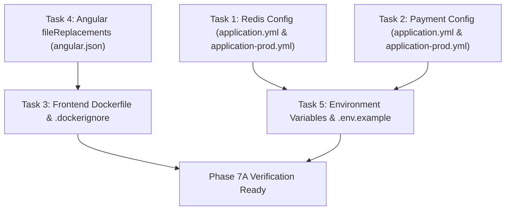

# IslandRide — Phase 7A: Production Infrastructure & Configuration Implementation Plan

**Date:** 2026-11-13  
**Status:** PROPOSED (Enhanced with Additional Acceptance Criteria — Awaiting Authorization)  
**Author:** Antigravity Autonomous Security & Architecture Review  
**Git Baseline Commit:** `79feed3`  
**Target Milestone:** Phase 7A — Production Configuration & Infrastructure Remediation  
**Deliverable Document:** `docs/islandride-phase-7a-implementation-plan.md`  

---

## 1. Executive Summary & Objective

During the Phase 7 Production Readiness Audit (`docs/islandride-phase-7-production-readiness-audit.md`), critical gaps were identified in production configuration, container packaging, environment variable alignment, and runtime plumbing. 

The primary objective of **Phase 7A** is to remediate these infrastructure, deployment, and configuration deficiencies without altering underlying business domain rules or database schemas.

### Scope of Phase 7A
1. **Production Redis Configuration:** Bind and configure Redis under `spring.data.redis` for the `prod` profile, supporting authentication, custom ports, SSL/TLS, and connection timeouts, while strictly preserving local development defaults.
2. **Payment Gateway Production Configuration:** Expose and map `islandride.payment.*` configuration properties in `application.yml` and `application-prod.yml` to support live Razorpay credentials, webhook secret verification, and live gating, while preserving mock payment mode for local development.
3. **Frontend Dockerfile & Docker Build-Context Correction:** Restructure `infrastructure/docker/frontend.Dockerfile` to resolve incompatible copy paths, align with the repository root build context, verify correct Nginx configuration copying, and introduce a root `.dockerignore` file.
4. **Frontend Production Environment Configuration:** Configure `fileReplacements` in `frontend/angular.json` under `architect.build.configurations.production` to ensure `environment.prod.ts` is substituted during production builds, confirm no hardcoded localhost API URLs remain in the compiled bundle, and ensure the production API URL is configurable.
5. **Production Environment Variables & Secrets Management:** Harmonize environment variable names across `.env.example`, `application.yml`, `application-prod.yml`, and `docker-compose.yml` to eliminate naming mismatches without hardcoding production credentials.

---

## 2. Validation & Problem Confirmation Matrix

Before planning any changes, each finding from the Phase 7 audit was verified against the actual source code and configuration files.

| Scope Domain | Audit Finding ID | Target Files Inspected | Current Implementation Status | Confirmed Problem | Regression Risk |
| :--- | :--- | :--- | :--- | :--- | :--- |
| **1. Redis Configuration** | `FINDING-CRIT-04` | `backend/src/main/resources/application-prod.yml`<br>`application-local.yml` | `application-local.yml` lines 37–43 configures `spring.data.redis`. `application-prod.yml` has **zero** Redis settings. | **CONFIRMED:** `SPRING_PROFILES_ACTIVE=prod` defaults to `localhost:6379` without password, ignoring `REDIS_HOST`, `REDIS_PORT`, and `REDIS_PASSWORD`. | **Zero risk to local dev:** Local profile continues reading `application-local.yml`. |
| **2. Payment Gateway Config** | `FINDING-CRIT-01` | `backend/src/main/resources/application-prod.yml`<br>`application.yml`<br>`PaymentGatewayProperties.java` | `PaymentGatewayProperties.java` uses `@ConfigurationProperties(prefix = "islandride.payment")`. Neither `application.yml` nor `application-prod.yml` defines this block. | **CONFIRMED:** Defaults to `provider = "mock"` and `liveEnabled = false`. Environment variables in `.env.example` (`RAZORPAY_KEY_ID`, etc.) are ignored by Spring. | **Zero risk to mock dev:** Base default remains `mock` when live credentials are not supplied. |
| **3. Frontend Docker Context** | `FINDING-HIGH-03` | `infrastructure/docker/frontend.Dockerfile`<br>`infrastructure/nginx/default.conf` | Line 8 expects `COPY package*.json ./` from context; line 16 expects `COPY ./infrastructure/nginx/default.conf` from context. | **CONFIRMED:** Cannot be built from repository root (missing `package.json`) or `frontend/` (missing `../infrastructure`). Fails in standard CI/CD docker build. | **Zero risk to local dev:** Local startup uses `ng serve` and does not invoke the Dockerfile. |
| **4. Frontend Environment Config** | `FINDING-MED-01` | `frontend/angular.json`<br>`frontend/src/environments/` | `angular.json` lines 34–67 has no `fileReplacements` block in `configurations.production`. | **CONFIRMED:** Production bundle retains `environment.ts` (`production: false`, `apiBaseUrl: 'http://localhost:8080/api/v1'`) instead of `environment.prod.ts`. | **Zero risk to local dev:** `ng serve` uses `development` configuration by default. |
| **5. Env Var & Secrets Alignment** | `FINDING-CRIT-01`<br>`FINDING-HIGH-01` | `.env.example`<br>`application-prod.yml`<br>`docker-compose.yml` | `.env.example` uses `MYSQL_USER`, `MYSQL_PASSWORD`, `PAYMENT_GATEWAY_PROVIDER`. `application-prod.yml` uses `DB_USERNAME`, `DB_PASSWORD`. | **CONFIRMED:** Deploying with `.env.example` names causes Spring Boot startup failure due to missing `DB_USERNAME` and unmapped payment properties. | **Zero risk to local dev:** Dual-binding fallback `${DB_USERNAME:${MYSQL_USER}}` preserves existing setups. |

---

## 3. Deep-Dive Problem Analysis & Detailed Specifications

### Task 1: Production Redis Configuration

#### Current Implementation
In `backend/src/main/resources/application-local.yml` lines 37–43:
```yaml
  data:
    redis:
      host: ${REDIS_HOST:localhost}
      port: ${REDIS_PORT:6379}
      password: ${REDIS_PASSWORD:redis_dev_password}
      timeout: 2000ms
```
In `backend/src/main/resources/application.yml`: No `spring.data.redis` block exists.  
In `backend/src/main/resources/application-prod.yml`: No `spring.data.redis` block exists.

#### Problem
In production, Spring Boot auto-configures `LettuceConnectionFactory` using defaults: `localhost:6379` with no password. If deployed to container environments where Redis runs as a separate service (e.g. host `redis` or AWS ElastiCache), connection fails or attempts an insecure unauthenticated connection.

#### Proposed Solution
1. In `backend/src/main/resources/application.yml` (base), define baseline fallback defaults:
   ```yaml
   spring:
     data:
       redis:
         host: ${REDIS_HOST:localhost}
         port: ${REDIS_PORT:6379}
         password: ${REDIS_PASSWORD:}
         timeout: 2000ms
   ```
2. In `backend/src/main/resources/application-prod.yml`, define production-hardened Redis configuration with SSL support:
   ```yaml
   spring:
     data:
       redis:
         host: ${REDIS_HOST:localhost}
         port: ${REDIS_PORT:6379}
         password: ${REDIS_PASSWORD}
         timeout: 3000ms
         ssl:
           enabled: ${REDIS_SSL_ENABLED:false}
   ```
3. Maintain `application-local.yml` untouched so that local development workflows (`start-islandride.ps1`) continue using `localhost:6379` with `redis_dev_password`.

---

### Task 2: Payment Gateway Production Configuration

#### Current Implementation
`PaymentGatewayProperties.java` declares:
- Prefix: `islandride.payment`
- Fields: `provider` (default: `"mock"`), `liveEnabled` (default: `false`), `orderExpiryMinutes` (default: `15`), nested `razorpay` (`baseUrl`, `keyId`, `keySecret`, `webhookSecret`, `connectTimeoutSeconds`, `readTimeoutSeconds`), and nested `mock` (`keySecret`, `webhookSecret`).
Neither `application.yml` nor `application-prod.yml` defines the `islandride.payment` block.

#### Problem
Setting environment variables such as `PAYMENT_GATEWAY_PROVIDER=razorpay` or `RAZORPAY_KEY_ID=...` from `.env.example` has no effect because Spring expects `ISLANDRIDE_PAYMENT_PROVIDER` and `ISLANDRIDE_PAYMENT_RAZORPAY_KEY_ID`. In production, without explicit configuration, the payment system remains in mock mode, preventing live payments and potentially allowing simulated free checkouts.

#### Proposed Solution
1. In `backend/src/main/resources/application.yml`, define base properties preserving mock mode by default for local development:
   ```yaml
   islandride:
     payment:
       provider: ${ISLANDRIDE_PAYMENT_PROVIDER:${PAYMENT_GATEWAY_PROVIDER:mock}}
       live-enabled: ${ISLANDRIDE_PAYMENT_LIVE_ENABLED:${PAYMENT_LIVE_ENABLED:false}}
       order-expiry-minutes: ${ISLANDRIDE_PAYMENT_ORDER_EXPIRY_MINUTES:15}
       razorpay:
         base-url: ${RAZORPAY_BASE_URL:https://api.razorpay.com/v1}
         key-id: ${ISLANDRIDE_PAYMENT_RAZORPAY_KEY_ID:${RAZORPAY_KEY_ID:}}
         key-secret: ${ISLANDRIDE_PAYMENT_RAZORPAY_KEY_SECRET:${RAZORPAY_KEY_SECRET:}}
         webhook-secret: ${ISLANDRIDE_PAYMENT_RAZORPAY_WEBHOOK_SECRET:${RAZORPAY_WEBHOOK_SECRET:}}
         connect-timeout-seconds: ${RAZORPAY_CONNECT_TIMEOUT_SECONDS:10}
         read-timeout-seconds: ${RAZORPAY_READ_TIMEOUT_SECONDS:15}
       mock:
         key-secret: ${ISLANDRIDE_PAYMENT_MOCK_KEY_SECRET:mock-islandride-key-secret}
         webhook-secret: ${ISLANDRIDE_PAYMENT_MOCK_WEBHOOK_SECRET:mock-islandride-webhook-secret}
   ```
2. In `backend/src/main/resources/application-prod.yml`, configure production overrides:
   ```yaml
   islandride:
     payment:
       provider: ${ISLANDRIDE_PAYMENT_PROVIDER:${PAYMENT_GATEWAY_PROVIDER:razorpay}}
       live-enabled: ${ISLANDRIDE_PAYMENT_LIVE_ENABLED:${PAYMENT_LIVE_ENABLED:false}}
       order-expiry-minutes: ${ISLANDRIDE_PAYMENT_ORDER_EXPIRY_MINUTES:15}
       razorpay:
         base-url: ${RAZORPAY_BASE_URL:https://api.razorpay.com/v1}
         key-id: ${ISLANDRIDE_PAYMENT_RAZORPAY_KEY_ID:${RAZORPAY_KEY_ID}}
         key-secret: ${ISLANDRIDE_PAYMENT_RAZORPAY_KEY_SECRET:${RAZORPAY_KEY_SECRET}}
         webhook-secret: ${ISLANDRIDE_PAYMENT_RAZORPAY_WEBHOOK_SECRET:${RAZORPAY_WEBHOOK_SECRET}}
         connect-timeout-seconds: ${RAZORPAY_CONNECT_TIMEOUT_SECONDS:10}
         read-timeout-seconds: ${RAZORPAY_READ_TIMEOUT_SECONDS:15}
   ```
3. Keep `live-enabled` defaulting to `false` unless explicitly configured with live credentials; no real credentials will be committed or used during testing.

---

### Task 3: Frontend Dockerfile and Build-Context Correction

#### Current Implementation
`infrastructure/docker/frontend.Dockerfile`:
```dockerfile
# Stage 1: Build Angular Static Artifacts
FROM node:24-alpine AS build
WORKDIR /app
COPY package*.json ./
RUN npm ci --prefer-offline
COPY . .
RUN npm run build -- --configuration=production

# Stage 2: Serve via Nginx
FROM nginx:1.27-alpine
COPY --from=build /app/dist/islandride-frontend/browser /usr/share/nginx/html
COPY ./infrastructure/nginx/default.conf /etc/nginx/conf.d/default.conf
EXPOSE 80
CMD ["nginx", "-g", "daemon off;"]
```

#### Problem
- If run from root (`docker build -f infrastructure/docker/frontend.Dockerfile .`), line 8 (`COPY package*.json ./`) fails because `package.json` is located at `frontend/package.json`.
- If run from `frontend/` (`cd frontend && docker build -f ../infrastructure/docker/frontend.Dockerfile .`), line 16 (`COPY ./infrastructure/nginx/default.conf ...`) fails because `infrastructure/` is outside the build context.
- There is no `.dockerignore` file, meaning `docker build` transmits `node_modules` (300MB+), `.git` (100MB+), and `backend/target` into the Docker daemon.

#### Proposed Solution
1. Standardize the build context to the **repository root** for all Dockerfiles.
2. Update `infrastructure/docker/frontend.Dockerfile` to reference `frontend/` subpaths and include an Nginx health check:
   ```dockerfile
   # Stage 1: Build Angular Production Artifacts
   FROM node:24-alpine AS build
   WORKDIR /app
   COPY frontend/package*.json ./
   RUN npm ci --prefer-offline
   COPY frontend/ ./
   RUN npm run build -- --configuration=production

   # Stage 2: Serve via Hardened Nginx
   FROM nginx:1.27-alpine
   COPY --from=build /app/dist/islandride-frontend/browser /usr/share/nginx/html
   COPY infrastructure/nginx/default.conf /etc/nginx/conf.d/default.conf
   EXPOSE 80
   HEALTHCHECK --interval=30s --timeout=5s --retries=3 \
       CMD wget -q --spider http://localhost/ || exit 1
   CMD ["nginx", "-g", "daemon off;"]
   ```
3. Create `.dockerignore` at the repository root:
   ```dockerignore
   .git
   .github
   .idea
   .vscode
   **/node_modules
   **/target
   **/dist
   **/storage
   docs/screenshots
   *.log
   ```
4. Verify the built image locally by testing configuration syntax (`nginx -t`) and confirming static file serving, without performing production deployment.

---

### Task 4: Frontend Production Environment Configuration

#### Current Implementation
`frontend/angular.json` lines 34–67:
```json
          "configurations": {
            "production": {
              "optimization": { ... },
              "budgets": [ ... ],
              "outputHashing": "all"
            },
            "development": { ... }
          }
```
`frontend/src/environments/environment.ts`:
```typescript
export const environment = {
  production: false,
  apiBaseUrl: 'http://localhost:8080/api/v1',
  appName: 'IslandRide (Local Development)'
};
```
`frontend/src/environments/environment.prod.ts`:
```typescript
export const environment = {
  production: true,
  apiBaseUrl: '/api/v1',
  appName: 'IslandRide'
};
```

#### Problem
Without `fileReplacements` under `architect.build.configurations.production` in `angular.json`, the Angular build compiles `environment.ts` directly into the production bundle. Any code that inspects `environment.production` receives `false`, and any code referencing `environment.apiBaseUrl` will point to `http://localhost:8080/api/v1` instead of the production relative path `/api/v1`.

#### Proposed Solution
1. Add `fileReplacements` to `frontend/angular.json` under `projects.islandride-frontend.architect.build.configurations.production`:
   ```json
              "fileReplacements": [
                {
                  "replace": "src/environments/environment.ts",
                  "with": "src/environments/environment.prod.ts"
                }
              ],
   ```
2. Build the production bundle and inspect the compiled JavaScript to verify that no `http://localhost:8080` strings remain in the output artifacts and that `apiBaseUrl` resolves to `/api/v1`.

---

### Task 5: Production Environment Variables & Secrets Management

#### Current Implementation & Problem
A systematic audit between `.env.example`, `application.yml`, `application-prod.yml`, and `docker-compose.yml` identified key discrepancies:

| Variable Purpose | `.env.example` Name | `application-prod.yml` Name | `docker-compose.yml` Name | Status |
| :--- | :--- | :--- | :--- | :--- |
| Database Host | `MYSQL_HOST=localhost` | `DB_HOST` | N/A (service: `mysql`) | Mismatch |
| Database Port | `MYSQL_PORT=3307` | `DB_PORT` | `MYSQL_HOST_PORT` | Mismatch |
| Database Name | `MYSQL_DATABASE=islandride_db` | `DB_NAME` | `MYSQL_DATABASE` | Mismatch |
| Database User | `MYSQL_USER=islandride_user` | `DB_USERNAME` | `MYSQL_USER` | Mismatch |
| Database Password | `MYSQL_PASSWORD=...` | `DB_PASSWORD` | `MYSQL_PASSWORD` | Mismatch |
| Redis Host | `REDIS_HOST=localhost` | Missing | N/A (service: `redis`) | Mismatch |
| Redis Password | `REDIS_PASSWORD=...` | Missing | `REDIS_PASSWORD` | Mismatch |
| Payment Provider | `PAYMENT_GATEWAY_PROVIDER=mock` | Missing | N/A | Missing |
| Razorpay Key ID | `RAZORPAY_KEY_ID=...` | Missing | N/A | Missing |
| JWT Expiry | `JWT_EXPIRATION_MINUTES=15` | `JWT_ACCESS_EXPIRATION_MS` | N/A | Unit Mismatch |
| Refresh Expiry | `REFRESH_TOKEN_EXPIRATION_DAYS=7` | `JWT_REFRESH_EXPIRATION_MS` | N/A | Unit Mismatch |

#### Proposed Solution
1. In `application-prod.yml`, adopt dual-variable fallback syntax for all database and payment parameters:
   - `url: jdbc:mysql://${DB_HOST:${MYSQL_HOST:localhost}}:${DB_PORT:${MYSQL_PORT:3306}}/${DB_NAME:${MYSQL_DATABASE:islandride_db}}?...`
   - `username: ${DB_USERNAME:${MYSQL_USER}}`
   - `password: ${DB_PASSWORD:${MYSQL_PASSWORD}}`
   - `host: ${REDIS_HOST:localhost}`
   - `port: ${REDIS_PORT:6379}`
   - `password: ${REDIS_PASSWORD}`
2. Update `.env.example` to document canonical variable names and their production equivalents clearly, with unit comments (milliseconds vs minutes/days).
3. Ensure no real secrets or production passwords are committed to version control.

---

## 4. Exact Affected Files List & Immutability Commitments

```
┌─────────────────────────────────────────────────────────────────────────────┐
│                       PHASE 7A TARGET FILE MODIFICATIONS                    │
├───────────────────────────────────────────────────────┬────────────┬────────┤
│ File Path                                             │ Action     │ Risk   │
├───────────────────────────────────────────────────────┼────────────┼────────┤
│ backend/src/main/resources/application.yml            │ Modify     │ Low    │
│ backend/src/main/resources/application-prod.yml       │ Modify     │ Low    │
│ frontend/angular.json                                 │ Modify     │ Low    │
│ infrastructure/docker/frontend.Dockerfile             │ Modify     │ Low    │
│ .dockerignore                                         │ Create     │ Low    │
│ .env.example                                          │ Modify     │ Low    │
│ docs/islandride-phase-7a-implementation-plan.md       │ Update     │ None   │
└───────────────────────────────────────────────────────┴────────────┴────────┘
```

**Files Explicitly NOT Modified in Phase 7A:**
- Zero Java application code files.
- Zero TypeScript component or service files.
- Zero database migrations (Flyway V1–V14 remain untouched).
- Zero database entity or repository interfaces.
- Zero test classes.

---

## 5. Task Dependencies & Interaction Matrix



- **Tasks 1 & 2** modify the same configuration files (`application.yml` and `application-prod.yml`). They will be executed together to avoid duplicate edits.
- **Task 4** modifies `frontend/angular.json`. It must be completed prior to testing Task 3 so that the Docker build produces the correct production bundle.
- **Task 5** updates `.env.example` to reflect all variables added in Tasks 1 and 2.

---

## 6. Security & Secrets Considerations

1. **No Production Defaults for Sensitive Secrets:**
   - In `application-prod.yml`, `JWT_SECRET`, `DB_PASSWORD`, `REDIS_PASSWORD`, `RAZORPAY_KEY_SECRET`, and `RAZORPAY_WEBHOOK_SECRET` must **never** specify fallback defaults. Spring Boot will fail to start if any of these are missing in the `prod` profile, preventing insecure accidental deployments.
2. **Local Development Default Preservation:**
   - In `application.yml` and `application-local.yml`, local development defaults (`mock` provider, `redis_dev_password`, dummy JWT secret) are maintained so developers can continue running `start-islandride.ps1` without requiring external secrets or third-party accounts.
3. **Payment Safety:**
   - Real payment credentials will never be entered, tested, or committed.
   - `live-enabled` remains disabled (`false`) by default.
4. **Cookie Security:**
   - `__Host-refresh_token` cookie attributes (`secure: true`, `SameSite: Strict`, `HttpOnly: true`) remain strictly enforced in the production profile.
5. **SSL/TLS for External Services:**
   - MySQL datasource URL in `application-prod.yml` retains `useSSL=true&requireSSL=true&verifyServerCertificate=true`.
   - Redis configuration adds `ssl.enabled: ${REDIS_SSL_ENABLED:false}` for cloud providers requiring in-transit encryption (e.g. AWS ElastiCache / Redis Cloud).

---

## 7. Testing & Verification Strategy

Following implementation, the following rigorous multi-stage verification protocol will be executed:

### Stage 1: Angular Production Environment Verification
1. **Production Build Execution:**
   - Run `npm --prefix frontend run build` to confirm `fileReplacements` executes cleanly.
2. **Bundle Inspection & Localhost Sweep:**
   - Search the compiled bundle (`dist/islandride-frontend/browser/main-*.js` or `dist/islandride/browser/main-*.js`) for `http://localhost:8080`.
   - Confirm that zero occurrences of `http://localhost:8080` exist in the production bundle.
3. **Production API URL Configurability:**
   - Verify that `environment.prod.ts` exports `apiBaseUrl: '/api/v1'`, allowing Nginx reverse proxying to route `/api/` calls seamlessly without hardcoded hostnames.

### Stage 2: Docker Build & Packaging Verification
1. **Build Execution from Repository Root:**
   - Execute Docker build using the repository root as context:
     ```powershell
     docker build -f infrastructure/docker/frontend.Dockerfile -t islandride-frontend:test .
     ```
2. **Nginx Configuration & File Serving Verification:**
   - Test Nginx syntax inside the container:
     ```powershell
     docker run --rm islandride-frontend:test nginx -t
     ```
   - Verify that `/usr/share/nginx/html/index.html` exists and contains the Angular `<app-root>` tag.
3. **No Deployment:**
   - The test image is evaluated locally; no containers will be deployed or published to remote registries.

### Stage 3: Redis Configuration Verification
1. **Production Property Binding Validation:**
   - Verify that `spring.data.redis.host`, `port`, `password`, and `ssl.enabled` are parsed without error in the Spring context.
2. **Local Development Baseline Integrity:**
   - Verify that `application-local.yml` is untouched and continues to supply `redis_dev_password` and port `6379`.
3. **No Hardcoded Credentials:**
   - Confirm that `application-prod.yml` uses strict placeholders (`${REDIS_PASSWORD}`) without default credentials.

### Stage 4: Payment Gateway Configuration Verification
1. **Mock Mode Preservation:**
   - Verify that `application.yml` defaults `islandride.payment.provider` to `"mock"` and `live-enabled` to `false`.
2. **Credential Mapping Verification:**
   - Verify that `ISLANDRIDE_PAYMENT_RAZORPAY_KEY_ID` and `RAZORPAY_KEY_ID` map cleanly to `PaymentGatewayProperties.getRazorpay().getKeyId()`.
3. **Zero Real Transactions:**
   - Confirm no live HTTP calls to `api.razorpay.com` occur during testing.

### Stage 5: Full Regression Testing Suite
1. **Frontend CI Tests:**
   - Execute `npm --prefix frontend run test:ci` to ensure all 35 Karma unit tests pass.
2. **Frontend Production Build:**
   - Confirm Angular production build completes with exit code 0 and style budget compliance.
3. **Backend Full Test Suite:**
   - Execute `.\backend\mvnw.cmd -f backend/pom.xml test` to verify all 11+ integration tests pass.
4. **Backend Production Profile Validation:**
   - Validate that Spring Boot's application context boots successfully with the `prod` profile using mock/test environment variables.
5. **Docker Compose Validation:**
   - Validate `docker compose config` exits with code 0.

---

## 8. Rollback Strategy

1. **Clean Git Reversion:**
   - Because Phase 7A only touches configuration files (`.yml`, `.json`, Dockerfiles, `.env.example`, `.dockerignore`), any unexpected issue can be instantly and safely rolled back via:
     ```powershell
     git revert HEAD
     ```
2. **Zero Database Impact:**
   - Phase 7A introduces no database schema migrations, column alterations, or data mutations. Rollback requires zero database intervention or data patching.

---

## 9. Comprehensive Acceptance Criteria

Phase 7A will be considered complete and ready for formal approval when all of the following criteria are satisfied:

### 1. Angular Production Environment Criteria
- [ ] Production build (`npm --prefix frontend run build`) successfully replaces `environment.ts` with `environment.prod.ts` via `fileReplacements` in `angular.json`.
- [ ] Inspection of the generated production bundle confirms zero occurrences of `http://localhost:8080`.
- [ ] Production API URL resolves to `/api/v1`, confirming that API requests are routed through the reverse proxy.
- [ ] Application bundle generation completes with exit code 0 and meets all budget constraints (`anyComponentStyle: 8kB / 16kB`).

### 2. Docker Build Criteria
- [ ] `infrastructure/docker/frontend.Dockerfile` builds cleanly using the repository root (`.`) as the build context.
- [ ] Nginx configuration (`infrastructure/nginx/default.conf`) is verified copied to `/etc/nginx/conf.d/default.conf` within the container.
- [ ] Container filesystem verification confirms static Angular artifacts reside in `/usr/share/nginx/html`.
- [ ] `.dockerignore` exists at the repository root and excludes `node_modules`, `target`, `.git`, and `storage`.
- [ ] No container is deployed to production or published to remote registries.

### 3. Redis Configuration Criteria
- [ ] `application-prod.yml` binds `spring.data.redis.host`, `port`, `password`, `timeout`, and `ssl.enabled`.
- [ ] Local development configuration in `application-local.yml` remains completely unchanged.
- [ ] `application-prod.yml` contains zero hardcoded Redis credentials (strictly uses `${REDIS_PASSWORD}`).

### 4. Payment Configuration Criteria
- [ ] Local development preserves mock payment mode (`provider: mock`, `live-enabled: false`) by default.
- [ ] Live payment calls remain disabled unless `islandride.payment.live-enabled` is explicitly set to `true`.
- [ ] Zero real payment credentials are used and zero live transactions are executed.
- [ ] Razorpay configuration properties (`key-id`, `key-secret`, `webhook-secret`, `base-url`) are verified bound to `PaymentGatewayProperties`.

### 5. Regression Testing Criteria
- [ ] Frontend CI tests pass 100% (all 35 Karma unit tests pass).
- [ ] Frontend production build passes with exit code 0.
- [ ] Backend integration test suite passes 100% (`.\backend\mvnw.cmd test`).
- [ ] Backend production profile configuration validates without property parsing errors.
- [ ] Docker compose configuration validates cleanly (`docker compose config`).
- [ ] Git working tree is clean and changes are committed and pushed to `origin/main`.

---

## 10. Recommended Implementation Sequence

Once approved, the implementation will proceed strictly in this sequence:

1. **Step 1:** Modify `backend/src/main/resources/application.yml` and `backend/src/main/resources/application-prod.yml` to add Redis and Payment gateway configuration with dual-binding fallbacks.
2. **Step 2:** Update `.env.example` to align all environment variables, canonical names, and unit comments.
3. **Step 3:** Update `frontend/angular.json` to add `fileReplacements` under `configurations.production`.
4. **Step 4:** Update `infrastructure/docker/frontend.Dockerfile` and create root `.dockerignore`.
5. **Step 5:** Execute frontend production build (`npm --prefix frontend run build`), inspect output bundles for localhost references, and verify environment substitution.
6. **Step 6:** Execute backend compilation and test suite (`mvnw test-compile` and `mvnw test`) to verify configuration syntax and property binding.
7. **Step 7:** Validate Docker build syntax and build frontend image locally from repository root without deploying.
8. **Step 8:** Document execution results, confirm all acceptance criteria, commit, and push Phase 7A implementation.
