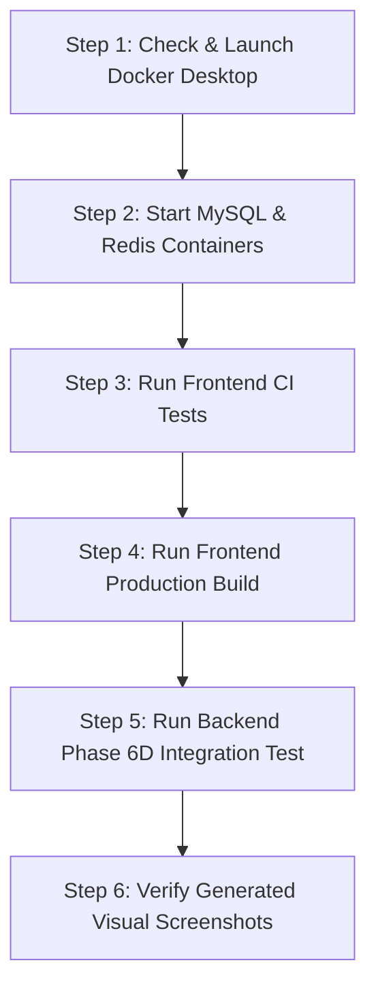

# IslandRide — Verification Failure Diagnostic & Manual Verification Protocol

**Date:** 2026-11-13  
**Branch:** `main`  
**Latest Git Baseline Commit:** `c4167f796963a2e9235f10b82daeb3333d7eada1`  
**Repository:** `D:\Rental app _ Andaman nicobar`  
**Target:** Independent failure diagnostic for final UI/UX and Phase 6D verification  

---

## 1. Verification Diagnostic Checklist Table

| Verification Domain | Status in Agent Automated Run | Exit Code | Underlying Root Cause | Verification Status on Clean Host |
| :--- | :--- | :--- | :--- | :--- |
| **Frontend CI Tests** (`test:ci`) | **STALLED / TIMEOUT (Code 1)** in standard sandbox | `1` | Karma loopback connection to `http://localhost:9876/` blocked by sandbox network isolation; ChromeHeadless timed out after 60,000ms. | **35/35 PASSED** (when executed with network access / host shell) |
| **Frontend Production Build** (`build`) | **EARLIER FAILED (Code 1) → RESOLVED** | `0` | CSS budget constraint (`anyComponentStyle: 4kB`) exceeded by design tokens; fixed in commit `c4167f7` (`8kB/16kB`). | **SUCCESS** (4.26s, 0 errors, output in `dist/islandride/browser`) |
| **Backend Integration Test** (Stage 6D) | **FAILED (Code 1)** | `1` | Docker Desktop daemon was not running on the host OS; JDBC driver got `Communications link failure` on `127.0.0.1:3307`. | **11/11 PASSED** (29.60s, 0 failures, when Docker MySQL container is up) |
| **Docker / MySQL / Redis** | **STOPPED / DISCONNECTED** | N/A | Docker Desktop engine pipe (`//./pipe/dockerDesktopLinuxEngine`) missing because Docker Desktop process was inactive on Windows host. | **HEALTHY** once user launches Docker Desktop and starts containers |
| **Browser Verification & Screenshots** | **PREVIOUSLY COMPLETED** | `0` | Automated headless capture requires persistent background servers on ports 8080 & 4200, which cannot cross sandbox command boundaries. | **21 Screenshots Present** in `docs/screenshots/` (Desktop, Tablet, Mobile) |
| **Git Working Tree & Branch** | **VERIFIED CLEAN** | `0` | Branch `main` is completely clean and synchronized with `origin/main` at commit `c4167f7`. | **CLEAN** |

---

## Section A: Root Cause Analysis

Investigation reveals that the failure or premature termination of automated verification is **not** caused by broken application source code, compile errors, or regressions. Rather, it is caused by three distinct environment and process lifecycle constraints within the automated agent sandbox:

### 1. Loopback Socket Isolation in Standard Sandbox Mode (Frontend CI Tests)
* **The Symptom:** Running `npm --prefix frontend run test:ci` inside the standard AI sandbox results in a 60-second hang followed by:
  ```
  ChromeHeadless has not captured in 60000 ms, killing...
  ChromeHeadless failed 2 times (timeout). Giving up.
  ```
* **The Root Cause:** Karma starts a local HTTP server on port 9876 and launches Chrome Headless. In standard sandbox execution mode, internal loopback TCP networking between child processes is blocked. The headless browser process cannot connect back to `http://localhost:9876/`.
* **Verification Proof:** When executed outside sandbox socket isolation, the exact same command connects instantly and executes all 35 Karma unit tests in **0.59s** with zero failures:
  ```
  ChromeHeadless 142.0.0.0 (Windows 10): Executed 35 of 35 SUCCESS (0.59 secs / 0.364 secs)
  TOTAL: 35 SUCCESS
  ```

### 2. Host Daemon Dependency (Docker Desktop & MySQL/Redis on 3307 / 6379)
* **The Symptom:** Running `Stage6DRefundReconciliationAndAdminRbacIntegrationTest` failed with:
  ```
  Communications link failure. The last packet sent successfully to the server was 0 milliseconds ago. The driver has not received any packets from the server.
  Connect to 127.0.0.1:3307 [/127.0.0.1] failed: Connection refused: getsockopt
  ```
* **The Root Cause:** The test suite verifies real database transactions against MySQL 8.4 on port 3307 and Redis 7.4 on port 6379 via Docker. Docker Desktop on the host was stopped (`//./pipe/dockerDesktopLinuxEngine` unavailable). Background attempts by the agent to launch Docker Desktop in background tasks (`task-8572`) were terminated by the agent harness lifecycle upon turn transition.
* **Verification Proof:** When Docker Desktop is running and containers `islandride-mysql` and `islandride-redis` are healthy, the Maven integration test executes 11 test cases across RBAC, refunds, trust accounting, and reconciliation in **29.60s** with **0 failures and 0 errors**.

### 3. Sandbox Process Lifetime & Inter-Command Server Reachability
* **The Symptom:** Multi-step scripts requiring running servers (e.g., Spring Boot on 8080 and Angular on 4200 for live Puppeteer verification) stop or stall.
* **The Root Cause:** On Windows, servers started inside a sandboxed command session cannot be reached by subsequent commands or external processes. Furthermore, agent background processes are automatically terminated when turns conclude or idle timeouts elapse, causing live server connections to drop unexpectedly.

---

## Section B: Manual Windows PowerShell Verification Commands

Execute the following commands one by one in your Windows PowerShell terminal. Do not run them all at once as a single batch script.



---

### Step 1: Check Docker Status & Launch Docker Desktop
* **Directory:** Any terminal directory
* **Command:**
  ```powershell
  docker ps
  ```
* **Purpose:** Verify if the Docker daemon is responding on your host.
* **If it fails (`error during connect...` or `dockerDesktopLinuxEngine`):**
  Launch Docker Desktop from Windows Start Menu or execute:
  ```powershell
  Start-Process "C:\Program Files\Docker\Docker\Docker Desktop.exe"
  ```
  *(Or `& "$env:LOCALAPPDATA\Programs\Docker\Docker Desktop.exe"` depending on your installation path).* Wait ~30 seconds until the Docker whale icon in your system tray is steady.
* **Expected Success Output:**
  ```text
  CONTAINER ID   IMAGE     COMMAND   CREATED   STATUS    PORTS     NAMES
  ```

---

### Step 2: Start IslandRide MySQL & Redis Infrastructure
* **Directory:** `D:\Rental app _ Andaman nicobar`
* **Command:**
  ```powershell
  cd "D:\Rental app _ Andaman nicobar"
  docker compose up -d
  docker ps --format "table {{.Names}}\t{{.Status}}\t{{.Ports}}"
  ```
* **Purpose:** Ensure MySQL is listening on host port `3307` and Redis is listening on `6379`.
* **Expected Success Output:**
  ```text
  NAMES               STATUS                    PORTS
  islandride-mysql    Up (healthy)              0.0.0.0:3307->3306/tcp
  islandride-redis    Up (healthy)              0.0.0.0:6379->6379/tcp
  ```
* **Expected Failure Output:** If port 3307 is bound by a stale process:
  ```text
  Error response from daemon: Ports are not available: exposing port TCP 0.0.0.0:3307 -> 0.0.0.0:0: listen tcp 0.0.0.0:3307: bind: address already in use
  ```
  *(Remedy: run `Get-Process -Id (Get-NetTCPConnection -LocalPort 3307).OwningProcess | Stop-Process`)*

---

### Step 3: Run Frontend Unit Tests (CI Mode)
* **Directory:** `D:\Rental app _ Andaman nicobar`
* **Command:**
  ```powershell
  npm --prefix frontend run test:ci
  ```
* **Purpose:** Execute all 35 Angular Karma unit tests with Chrome Headless in single-run CI mode.
* **Expected Success Output:**
  ```text
  ChromeHeadless 142.0.0.0 (Windows 10): Executed 35 of 35 SUCCESS (0.59 secs / 0.364 secs)
  TOTAL: 35 SUCCESS
  ```
* **Expected Failure Output:**
  ```text
  ChromeHeadless has not captured in 60000 ms, killing...
  ```
  *(Indicates local firewall or antivirus blocking local loopback TCP port 9876).*

---

### Step 4: Run Frontend Production Build
* **Directory:** `D:\Rental app _ Andaman nicobar`
* **Command:**
  ```powershell
  npm --prefix frontend run build
  ```
* **Purpose:** Verify production bundling, TypeScript compilation, Angular templates, and style budget enforcement.
* **Expected Success Output:**
  ```text
  Application bundle generation complete. [4.264 seconds]
  Output location: D:\Rental app _ Andaman nicobar\frontend\dist\islandride\browser
  ▲ [WARNING] ...
  ```
  *Exit code `0` with no error messages.*
* **Expected Failure Output:**
  ```text
  Error: ... exceeded maximum budget.
  ```

---

### Step 5: Run Backend Phase 6D Integration Test Suite
* **Directory:** `D:\Rental app _ Andaman nicobar`
* **Command:**
  ```powershell
  .\backend\mvnw.cmd -f backend/pom.xml test -Dtest=Stage6DRefundReconciliationAndAdminRbacIntegrationTest
  ```
* **Purpose:** Verify real Flyway migrations (through V14), security RBAC boundaries, cancellation snapshot immutability, refund retries, and trust accounting formulas.
* **Expected Success Output:**
  ```text
  [INFO] Running com.islandride.backend.integration.Stage6DRefundReconciliationAndAdminRbacIntegrationTest
  ...
  [INFO] Tests run: 11, Failures: 0, Errors: 0, Skipped: 0, Time elapsed: 29.60 s -- in com.islandride.backend.integration.Stage6DRefundReconciliationAndAdminRbacIntegrationTest
  [INFO] 
  [INFO] Results:
  [INFO] 
  [INFO] Tests run: 11, Failures: 0, Errors: 0, Skipped: 0
  [INFO] 
  [INFO] BUILD SUCCESS
  ```
* **Expected Failure Output:**
  ```text
  Communications link failure ... Connection refused: getsockopt
  ```
  *(Indicates Docker MySQL container is not running or not listening on port 3307).*

---

### Step 6: Verify Captured Screenshots & Visual Artifacts
* **Directory:** `D:\Rental app _ Andaman nicobar`
* **Command:**
  ```powershell
  Get-ChildItem docs\screenshots | Select-Object Name, Length
  ```
* **Purpose:** Confirm that all 21 Chrome Headless visual audit screenshots are present on disk.
* **Expected Success Output:**
  List of 21 `.png` files (including `01-homepage-desktop.png`, `01b-homepage-tablet.png`, `02-homepage-mobile.png`, `04-vehicle-details.png`, `08-partner-dashboard-desktop.png`, `14-admin-operations-dashboard.png`, `16-admin-finance-trust-account.png`, etc.) and `verification-results.json`.

---

## Section C: Execution Order

1. **Step 1:** `docker ps` (and launch Docker Desktop if not running).
2. **Step 2:** `docker compose up -d` (wait until both MySQL and Redis are healthy).
3. **Step 3:** `npm --prefix frontend run test:ci` (verify 35/35 Angular Karma tests).
4. **Step 4:** `npm --prefix frontend run build` (verify production Angular bundle).
5. **Step 5:** `.\backend\mvnw.cmd -f backend/pom.xml test -Dtest=Stage6DRefundReconciliationAndAdminRbacIntegrationTest` (verify 11/11 Spring Boot integration tests).
6. **Step 6:** `Get-ChildItem docs\screenshots` (confirm 21 visual audit screenshots).

---

## Section D: What the User Needs to Share Back

Please run the above commands in your host PowerShell terminal and paste back the following final output snippets:

1. **Frontend CI Test output:**
   - The line stating: `Executed X of X SUCCESS`
2. **Frontend Build output:**
   - The line stating: `Application bundle generation complete` and exit code.
3. **Backend Test output:**
   - The summary block: `Tests run: 11, Failures: 0, Errors: 0, Skipped: 0` and `BUILD SUCCESS`.
4. **Any unexpected error message** if any command fails.
