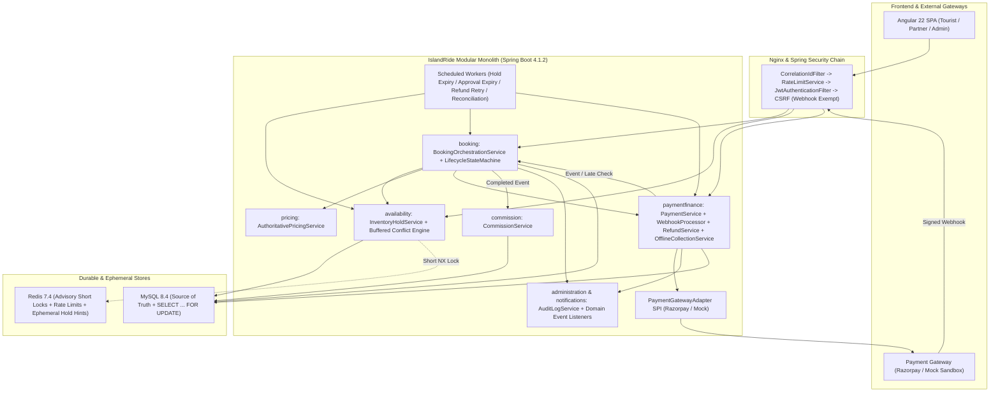
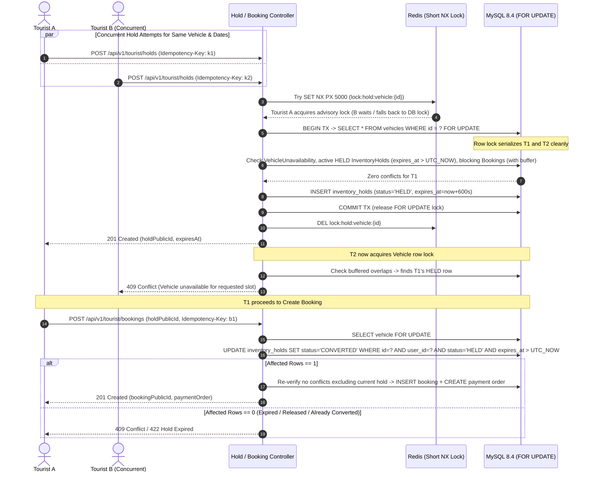
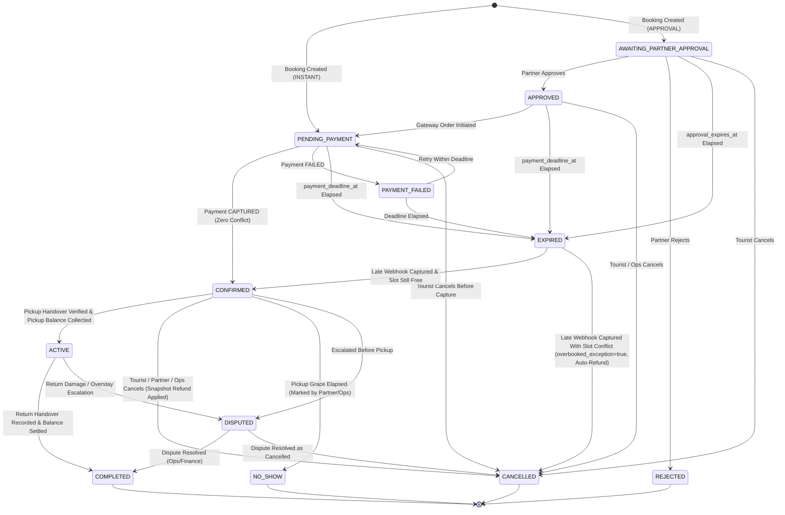

# IslandRide — Phase 6: Booking Lifecycle, Inventory Holds & Payments Implementation Plan

**Status:** Planning Only (Awaiting Explicit User Approval Before Implementation)  
**Baseline Commit:** `5ee7b01` (`main`, Phase 5 Accepted)  
**Stack:** Angular 22 + TypeScript, Java 25, Spring Boot 4.1.2, MySQL 8.4, Spring Data JPA / Hibernate, Redis 7.4, Flyway, Docker Compose, Nginx  

> [!IMPORTANT]
> This document is the Phase 6 architectural and implementation blueprint. No migrations, entities, services, controllers, or frontend views have been written or modified yet. Section 16 isolates every unresolved business, accounting, and operational decision requiring explicit sign-off prior to coding.

---

## 1. Executive Summary & Phase 6 Scope Boundary

Phase 6 transforms IslandRide from an authenticated, moderated multi-vendor vehicle catalog (Phases 1–5) into a transactional marketplace where tourists can safely reserve vehicles across the Andaman & Nicobar Islands, partners can manage approvals and pickup balance collections, and platform finance/operations teams can reconcile payments, refunds, and commissions reliably.

### 1.1 In Scope for Phase 6
- **Authoritative Server-Side Pricing & Policy Preview:** Deterministic calculation using Phase 5 `VehiclePricingPlan`, `PricingRule`, `SeasonalPrice`, `PartnerPolicy`, and `SystemSetting` (`INR`, GST `%`), freezing immutable price and cancellation-policy snapshots onto every created booking.
- **Durable Inventory Holds & Turnaround Concurrency:** MySQL-backed `InventoryHold` records + Redis ephemeral coordination locks, `SELECT ... FOR UPDATE` pessimistic vehicle-row serialization, symmetric turnaround buffer interval enforcement across Catalog/Availability/Holds/Bookings, and strict `Idempotency-Key` guarantees.
- **End-to-End Booking Lifecycle:** Server-resolved `BookingMode` (`INSTANT` and `APPROVAL`), Andaman same-island / hub pickup-return rules, minimal consistent state machine (`PENDING_PAYMENT`, `PAYMENT_FAILED`, `AWAITING_PARTNER_APPROVAL`, `APPROVED`, `REJECTED`, `CONFIRMED`, `ACTIVE`, `COMPLETED`, `CANCELLED`, `EXPIRED`, `NO_SHOW`, `DISPUTED`), and automatic hold/approval deadline expiration.
- **Decoupled Payment Gateway & Webhooks:** `PaymentGatewayAdapter` SPI with primary Razorpay integration and profile-gated `MockGatewayAdapter`, `FULL` and `PARTIAL_ADVANCE` (`PaymentMode`), constant-time HMAC-SHA256 webhook signature verification, idempotent `payment_webhook_events` deduplication, frontend fallback verification, out-of-order protection, and late-payment `OVERBOOKED_EXCEPTION` detection + automatic full refund.
- **Offline Pickup Collection & Financial Ledger:** Partner-recorded Cash/UPI balance collection (`OfflineCollection`), refundable security deposit trust-liability tracking separated from rental commission base, `Commission` generation on completion, async `Refund` state machine with exponential backoff retries, and scheduled gateway reconciliation.
- **Multi-Tenant Partner, Tourist, Operations & Finance Portals:** Angular 22 standalone UI flows (Catalog preview, Checkout countdown & gateway trigger, Tourist booking history/detail/cancel, Partner approval & pickup collection drawer, Operations & Finance Admin queues) backed by RBAC and `TenantSecurityService` isolation.

### 1.2 Explicit Phase 6 Boundaries (Hooks Preserved for Later Phases)
- **Automated Partner Bank Payout Execution (`Settlement` disbursement API):** Phase 6 generates `Commission` ledger rows and preserves `settlements`/`settlement_items` compatibility, while automated bank payout batching/NEFT/IMPS UTR payout workflows remain scoped for dedicated Settlement Disbursement work unless included later.
- **Full Damage Claim & Evidence Photo Dispute Workflow (`HandoverEvidence` / `DamageReport`):** Phase 6 updates `HandoverInspection` / pickup-return checkpoints cleanly to gate trip start (`ACTIVE`), offline pickup balance collection, completion (`COMPLETED`), and security-deposit hold/release status without expanding into full multi-photo damage arbitration.
- **Full Omnichannel Notification Provider Integrations (SMS/WhatsApp):** Phase 6 emits domain events (`ApplicationEventPublisher`) into the `notifications` module (`Notification` / `NotificationTemplate` persistence and existing `EmailService` dispatch); external SMS/WhatsApp provider onboarding remains decoupled.

---

## 2. Existing Implementation & Schema Assessment (Phase 1–5 Baseline)

Phase 3–5 already laid significant database and package foundations inside the repository. Phase 6 **must reuse and extend these existing artifacts cleanly** rather than duplicating tables, enums, or security services.

### 2.1 Existing Artifacts to Reuse

| Module (`com.islandride.*`) | Existing Domain / Schema Artifacts (`V3`–`V10`) | Existing Services / Repositories / Controllers | Phase 6 Action |
|---|---|---|---|
| `inventory` | `vehicles`, `vehicle_categories`, `vehicle_unavailability`, `BookingMode` (`INSTANT`, `APPROVAL`), `VehicleStatus`, `BlockType` | `VehicleRepository` (already defines `@Lock(PESSIMISTIC_WRITE)` `findByIdForUpdate` and `findByPublicIdForUpdate`), `VehicleUnavailabilityRepository`, `PublicCatalogService` | Share unified turnaround-buffered conflict helper; enforce `APPROVED` business + `ACTIVE` vehicle + pickup/return location & `allowDifferentReturnSameIsland` checks. |
| `availability` | `inventory_holds` (`V5`: `public_id`, `vehicle_id`, `user_id`, `start_time`, `end_time`, `hold_duration_seconds`, `status`=`HELD`, `expires_at`), `HoldStatus` (`HELD`, `CONVERTED`, `EXPIRED`, `RELEASED`) | `InventoryHoldRepository`, `AvailabilityService` (maintenance/manual blocks & calendar view) | Upgrade `InventoryHold` with idempotency/purpose metadata; replace non-buffered overlap check in `AvailabilityService` & `PublicCatalogService` with canonical turnaround-buffered query; add hold acquire/release/expiry services. |
| `pricing` | `vehicle_pricing_configs` (`V10`), `pricing_rules` (`V5`), `seasonal_prices` (`V5`), `partner_policies` (`V5`: `min_rental_hours`, `max_rental_days`, `turnaround_buffer_minutes`, `advance_payment_percentage`, `cancellation_deadline_hours`, `free_cancellation_allowed`, `cancellation_fee_percentage`, `deposit_inspection_window_hours`) | `VehiclePricingService` (`platform.currency`, `platform.gst.percentage`), `VehiclePricingPlanRepository`, `PricingRuleRepository`, `SeasonalPriceRepository`, `PartnerPolicyRepository` | Build `AuthoritativePricingService` consuming `VehiclePricingPlan` -> `SeasonalPrice` -> `PricingRule` -> `PartnerPolicy` -> `SystemSetting` and returning immutable snapshot payloads. |
| `booking` | `bookings` (`V6`), `booking_status_history` (`V6`), `handover_inspections` (`V6`), `handover_evidence` (`V6`), `BookingStatus`, `PaymentMode` (`FULL`, `PARTIAL_ADVANCE`), `HandoverType`, `EvidenceType` | `BookingRepository`, `HandoverInspectionRepository` | Extend `bookings` & `BookingStatus` cleanly via `V11`; implement `BookingLifecycleService`, `BookingExpirationJob`, `PartnerBookingService`, and Tourist/Partner/Admin controllers. |
| `paymentfinance` | `payments`, `payment_attempts`, `refunds`, `offline_collections` (`V7`), `PaymentStatus` (`INITIATED`, `CAPTURED`, `FAILED`, `REFUNDED`), `PaymentType` (`RENTAL_ADVANCE`, `RENTAL_FULL`, `PICKUP_BALANCE`, `SECURITY_DEPOSIT`), `PaymentMethod` (`GATEWAY`, `OFFLINE_CASH`, `OFFLINE_UPI`), `RefundStatus` (`PENDING`, `PROCESSING`, `SUCCESS`, `FAILED`, `RECONCILED`) | `PaymentRepository`, `PaymentAttemptRepository`, `RefundRepository`, `OfflineCollectionRepository` | Add `payment_webhook_events` table (`V11`); implement `PaymentGatewayAdapter` (`RazorpayGatewayAdapter`, `MockGatewayAdapter`), `PaymentService`, `WebhookService`, `RefundService`, `OfflineCollectionService`, and scheduled retry/reconciliation jobs. |
| `commission` | `commissions`, `settlements`, `settlement_items` (`V7`), `CommissionStatus`, `SettlementStatus` | `CommissionRepository`, `SettlementRepository` | Implement `CommissionCalculationService` listening for completed bookings and writing `Commission` rows (`gross - deposit - tax` rules per confirmed fee base). |
| `partner`, `geography`, `usermanagement` | `businesses` (`commission_rate`=4.00, `verification_status`), `business_locations` (`is_pickup_available`, `is_return_available`), `partner_staff`, `islands`, `locations`, `tourist_profiles` | `PartnerService`, `GeographyService`, `TouristProfileService`, `TenantSecurityService` | Enforce `TenantSecurityService.getAuthorizedBusinessIds()` & `requireBusinessReadAccess()` / booking write checks; snapshot tourist DL & emergency contact on booking creation. |
| `core`, `administration`, `notifications` | `system_settings`, `audit_logs`, `notifications`, `notification_templates`, `GlobalExceptionHandler`, `SecurityConfig`, `RateLimitService` | `AuditLogService`, `EmailService` (`LoggingEmailService` / `SmtpEmailService`), `AdminManagementController` | Add `@EnableScheduling` in `IslandRideApplication`; configure webhook CSRF exemption & HMAC guard in `SecurityConfig`; emit audit & notification domain events cleanly. |

### 2.2 Critical Discrepancies & Gaps Found in Repo (Reconciled by This Plan)

1. **`BookingMode` Enum Name (`APPROVAL` vs `PARTNER_APPROVAL`):**  
   `V4`, `V6`, `V10`, `com.islandride.inventory.domain.BookingMode`, and Angular `vehicle.models.ts` already define `INSTANT | APPROVAL`. Keeping the canonical enum value **`APPROVAL`** preserves backward compatibility with existing Phase 5 data while rendering clear `"Partner Approval"` UI labels.
2. **`BookingStatus` Completeness & Blocking Status Set:**  
   `BookingStatus` currently contains 10 states (`PENDING_PAYMENT`, `PAYMENT_FAILED`, `AWAITING_PARTNER_APPROVAL`, `APPROVED`, `REJECTED`, `CONFIRMED`, `ACTIVE`, `COMPLETED`, `CANCELLED`, `DISPUTED`) and omits **`EXPIRED`** and **`NO_SHOW`**. Concurrently, `AvailabilityService.NON_BLOCKING_BOOKING_STATUSES` currently lists only `{PAYMENT_FAILED, REJECTED, CANCELLED, COMPLETED}`. Adding `EXPIRED` and `NO_SHOW` to `BookingStatus` and including both in the canonical non-blocking status set prevents stale unpaid or no-show records from permanently locking fleet calendar slots.
3. **Approval Deadline Tiers Mismatch (`V8` vs Phase 1 `business-rules.md`):**  
   `V8__reviews_support_notifications_admin_schema.sql` and `application.yml` seed `approval.deadline.hours.long = 6` (`> 24h away`), `approval.deadline.hours.medium = 2` (`6–24h away`), and `approval.deadline.minutes.urgent = 45` (`< 6h away`), whereas Phase 1 `docs/01-requirements/business-rules.md` specifies `> 48h`, `12–48h`, `< 12h`. Section 16 Decision #6 requests explicit confirmation on the canonical hour thresholds before Phase 6 enforcement.
4. **Turnaround Buffer Not Yet Applied in Availability / Catalog Queries:**  
   `V4` (`vehicles.turnaround_buffer_minutes`) and `V5` (`partner_policies.turnaround_buffer_minutes`) exist, yet Phase 5 `AvailabilityService` and `PublicCatalogService` currently perform raw `[start, end)` overlap checks without buffer padding, and duplicate the `NON_BLOCKING_BOOKING_STATUSES` list across modules. Phase 6 extracts one shared turnaround-buffered availability predicate used everywhere (search, detail calendar, hold creation, booking creation, and webhook late-claim validation).
5. **Missing Snapshot, Idempotency & Webhook Tables on Current Schema (`V6`–`V7`):**  
   `bookings` lacks `inventory_hold_id`, `idempotency_key`, frozen pricing/tax/buffer/currency fields, `pricing_breakdown_json`, `cancellation_policy_snapshot`, `payment_deadline_at`, `overbooked_exception`, and DL snapshot fields. `payment_webhook_events` does not yet exist to deduplicate incoming webhook event IDs. `partner_policies` / `business_locations` lack explicit opening/closing hours columns.
6. **Spring Scheduling & Mail/Gateway Dependencies:**  
   `IslandRideApplication` currently defines `@SpringBootApplication` and `@EnableAsync`, without `@EnableScheduling`. Adding `@EnableScheduling` activates background expiration, refund retry, and reconciliation jobs. `pom.xml` currently does not declare a Razorpay SDK or `spring-boot-starter-mail`; Razorpay integration can use Spring `RestClient` + JDK `HmacSHA256` (`javax.crypto.Mac`) directly—requiring zero heavy third-party HTTP wrappers—or the official Razorpay Java SDK once approved.
7. **API Prefix & CSRF Alignment (`SecurityConfig`):**  
   `SecurityConfig` configures `/api/v1/tourist/**` (`ROLE_TOURIST`), `/api/v1/partners/**` (plural, partner roles), `/api/v1/admin/**`, and CSRF protection via `CookieCsrfTokenRepository.withHttpOnlyFalse()`. Phase 6 endpoints will follow these exact pluralized portal paths and explicitly exempt `/api/v1/payments/webhooks/**` from CSRF token checks while enforcing mandatory raw-body HMAC-SHA256 signature verification and `permitAll()` routing.

---

## 3. System Architecture & Modular Monolith Boundaries

Phase 6 preserves the `com.islandride` package-by-module structure enforced by `ModuleBoundaryArchitectureTest` (`ArchUnit`). Controllers remain thin HTTP adapters; domain invariants, locking, and transactional boundaries live inside `@Service` facades; cross-cutting side effects (notifications, emails, commission accrual) trigger asynchronously or transactionally after commit via `ApplicationEventPublisher`.



---

## 4. End-to-End Booking Creation & Island Operations Workflow

### 4.1 Tourist Booking Flow (`INSTANT` and `APPROVAL`)
1. **Live Price & Availability Preview (Stateless):**  
   On the vehicle detail screen, the tourist picks `startTime`, `endTime` (validated in UTC converted from `Asia/Kolkata` island wall time), `pickupLocationPublicId`, `returnLocationPublicId`, and `paymentMode` (`FULL` or `PARTIAL_ADVANCE`). The backend validates operational eligibility and returns an itemized breakdown plus the active partner's cancellation policy summary.
2. **Acquire Durable Hold (`POST /api/v1/tourist/holds`, `Idempotency-Key` required):**  
   Backend verifies tourist identity, locks `Vehicle` (`SELECT ... FOR UPDATE`), verifies zero overlaps across `VehicleUnavailability`, active `InventoryHold`, and blocking `Booking` intervals (with symmetric turnaround buffer), and creates an `InventoryHold` (`status = HELD`, `expires_at = now + 600s`) returning `holdPublicId`, `expiresAt`, and server-computed checkout totals.
3. **Create Booking from Hold (`POST /api/v1/tourist/bookings`, `Idempotency-Key` required):**  
   Tourist submits `{ holdPublicId, pickupLocationId, returnLocationId, paymentMode, dlConfirmed, dlNumber, emergencyContact, specialRequests }`.  
   - **Authoritative Mode Resolution:** Backend reads `vehicle.getBookingMode()` directly from MySQL (`INSTANT` or `APPROVAL`), **ignoring any mode or monetary values sent by the client**.
   - **Single Vehicle Rule (MVP):** Each booking maps 1:1 to a single `vehicle_id`.
   - **Atomic Hold Conversion:** Inside the `Vehicle` `FOR UPDATE` transaction, backend atomically marks the hold `CONVERTED` (`WHERE id = ? AND user_id = ? AND status = 'HELD' AND expires_at > UTC_NOW`), inserts the `Booking` with frozen pricing & cancellation snapshots, and emits `BookingCreatedEvent`.
   - **Branch A — `BookingMode.INSTANT`:**  
     Booking starts in `PENDING_PAYMENT` with `payment_deadline_at = hold.expires_at`. Backend immediately creates a Gateway Order (`Payment` = `INITIATED`, `PaymentType` = `RENTAL_FULL` or `RENTAL_ADVANCE`), returning `gatewayOrderId`, `gatewayKeyId`, `amountInPaise`, and checkout config to open Razorpay / Mock payment UI.
   - **Branch B — `BookingMode.APPROVAL`:**  
     Under the recommended Pay-After-Approval flow (see Section 16 Decision #1), booking starts in `AWAITING_PARTNER_APPROVAL` with `approval_expires_at` calculated from pickup proximity tiers. Because the `Booking` itself in `AWAITING_PARTNER_APPROVAL` blocks overlapping dates in availability queries, the slot stays protected while awaiting partner review—without prematurely charging the tourist card. Once a `PARTNER_OWNER` or `PARTNER_MANAGER` approves (`APPROVED`), the backend sets `payment_deadline_at`, sends a payment link notification to the tourist, and lets the tourist initiate the Gateway Order (`POST /api/v1/tourist/bookings/{publicId}/payment-orders`).

### 4.2 Andaman Island & Operational Guardrails Enforced Before Hold/Booking
- **Business & Vehicle Eligibility:** `business.verificationStatus == APPROVED`, `business.deletedAt == null`, `vehicle.status == ACTIVE`, `vehicle.deletedAt == null`, `vehicle.category.active == true`.
- **Single-Island & Hub Return Rules:**  
  - Pickup and return `Location` records MUST be active and belong to the same `Island` (`pickup.island.id == return.island.id`; no cross-island vehicle returns via passenger ferries like Port Blair <-> Havelock).  
  - Pickup hub must match `vehicle.pickupLocation` (if vehicle-pinned) AND appear in partner `business_locations` with `isPickupAvailable == true`.  
  - Different return hub is permitted ONLY if `vehicle.allowDifferentReturnSameIsland == true` AND the return hub is enabled in partner `business_locations` (`isReturnAvailable == true`) on the same island.
- **Rental Window & Lead-Time Constraints:**  
  - `startTime < endTime`, `startTime >= now + minLeadTimeMinutes` (configurable `SystemSetting`, e.g., prevent bookings in the past).  
  - Rental duration respects effective `minRentalHours` (e.g., 6h) and `maxRentalDays` (e.g., 30d).
- **Operating Hours & Daylight Cutoff:**  
  - Validate pickup/return local timestamps (`Asia/Kolkata`) against partner/hub opening & closing hours once configured (Section 16 Decision #5).
- **Tourist Eligibility Snapshot:**  
  - Validate tourist account is `ACTIVE` and DL confirmation (`dlConfirmed == true`, DL number format) is provided before booking creation; snapshot `customerDlNumber` and `customerEmergencyContact` onto `bookings`.

---

## 5. Durable Inventory Holds, Turnaround Buffers & Concurrency Control

### 5.1 Dual-Layer MySQL + Redis Architecture
- **MySQL (`inventory_holds` & `bookings`) = Authoritative Durability Layer:** Survives Redis restarts/flushes and shares ACID transaction boundaries with bookings and payments.
- **Redis 7.4 = Ephemeral Fast-Path & Coordination Layer:**
  - Short-lived distributed mutex (`SET lock:hold:vehicle:{vehicleId} {token} NX PX 5000`) reduces lock wait queues under flash spikes before acquiring the MySQL row lock.
  - Optional TTL hint keys (`hold:ttl:{holdPublicId}`) power lightweight UX/telemetry without ever being trusted for conflict exclusion.
  - All correctness invariants MUST still pass if Redis is slow or unavailable (degrade gracefully to direct MySQL `SELECT ... FOR UPDATE`).

### 5.2 Turnaround Buffer Interval Math & Shared Exclusion Helper
Every vehicle has a `turnaroundBufferMinutes = coalesce(vehicle.turnaroundBufferMinutes, partnerPolicy.turnaroundBufferMinutes, systemSetting("turnaround.buffer.minutes.default"))` (default `60`).  
Because vehicle cleaning/inspection requires `buffer` minutes **after** every reservation ends before the **next** reservation starts, both the candidate interval `[reqStart, reqEnd)` and every existing interval `[exStart, exEnd)` block `[start, end + buffer)`:

$$\text{Conflict}([\text{reqStart}, \text{reqEnd}), [\text{exStart}, \text{exEnd}), \text{buffer}) \iff \text{exStart} < (\text{reqEnd} + \text{buffer}) \;\land\; (\text{exEnd} + \text{buffer}) > \text{reqStart}$$

**Boundary Verification Example (`buffer = 60 min`):**
- Existing booking `A`: `10:00` to `12:00` (effectively occupies `[10:00, 13:00)`).
- Request `B` (`13:00` to `15:00`): `13:00 > 13:00` is `false` -> **Allowed** (exact turnaround boundary).
- Request `C` (`12:30` to `14:30`): `10:00 < 15:30` AND `13:00 > 12:30` -> **Rejected** (`409 Conflict`).
- Request `D` (`07:00` to `09:30`): `10:00 < 10:30` (`reqEnd + buffer = 10:30`) AND `13:00 > 07:00` -> **Rejected** (only 30m turnaround before `A` starts).

> [!IMPORTANT]
> For `VehicleUnavailability` blocks (`MAINTENANCE`, `MANUAL_BLOCK`), evaluate whether turnaround buffer applies or exact block interval `[block.startTime, block.endTime)` suffices (recommended: exact block `[block.startTime, block.endTime)` for partner maintenance windows, buffered `[start, end + buffer)` for `InventoryHold` and `Booking` intervals). Both `AvailabilityService` and `PublicCatalogService` MUST invoke the single shared availability conflict predicate so search results never advertise slots that hold creation rejects.

### 5.3 Concurrency & Atomic Hold Conversion Sequence



### 5.4 Hold Release & Expiration Strategy
- **Zero Scheduler Reliance for Correctness:** Every conflict query and every `CONVERTED` update includes `AND expires_at > UTC_NOW`. Even if the background job stops temporarily, an expired hold NEVER blocks a new tourist and NEVER converts into a booking.
- **Background Cleanup:** `@Scheduled(fixedDelay = 30000)` transitions `HELD` holds with `expires_at <= UTC_NOW` to `EXPIRED` in bounded batches (`LIMIT 200`), keeping operational tables clean and audit trails accurate.
- **Explicit Tourist Release:** `POST /api/v1/tourist/holds/{holdPublicId}/release` checks ownership (`user_id == currentUserId`), marks `HELD -> RELEASED`, and frees the slot immediately when a tourist navigates away or cancels checkout.

---

## 6. Booking Lifecycle State Machine

### 6.1 State Machine Diagram



> [!NOTE]
> **Design Choice on `OVERBOOKED_EXCEPTION`:** Notice the diagram models late-payment overbooking via `overbooked_exception = true` + `CANCELLED` + immediate automatic `100% Refund` (keeping `BookingStatus` minimal while recording an unambiguous exception flag and high-priority alert). If preferred, `OVERBOOKED_EXCEPTION` can instead be a dedicated terminal/operational `BookingStatus` enum value — flagged explicitly in Section 16 Decision #8.

### 6.2 Allowed Transitions, Actors & Guard Conditions

| From State | Event / Trigger | To State | Authorized Actor(s) | Guard Conditions & Side Effects |
|---|---|---|---|---|
| *(new)* | Create Booking (`INSTANT`) | `PENDING_PAYMENT` | `TOURIST` | Valid active `HELD` hold owned by tourist -> hold becomes `CONVERTED`; snapshots frozen; gateway order created. |
| *(new)* | Create Booking (`APPROVAL`) | `AWAITING_PARTNER_APPROVAL` | `TOURIST` | Hold -> `CONVERTED`; `approval_expires_at` computed per lead-time tier; partner notified. |
| `AWAITING_PARTNER_APPROVAL` | Partner Approve | `APPROVED` | `PARTNER_OWNER`, `PARTNER_MANAGER` | `TenantSecurityService` membership check + `now < approval_expires_at`; sets `payment_deadline_at`; notifies tourist. |
| `AWAITING_PARTNER_APPROVAL` | Partner Reject | `REJECTED` | `PARTNER_OWNER`, `PARTNER_MANAGER` | Rejection reason required; slot unblocked immediately; tourist notified. |
| `AWAITING_PARTNER_APPROVAL` | Approval Timeout | `EXPIRED` | `SYSTEM_SCHEDULER` | `approval_expires_at <= now`; slot unblocked; notification sent. |
| `APPROVED` | Initiate Payment Order | `PENDING_PAYMENT` | `TOURIST` | `now < payment_deadline_at`; gateway order created/reused idempotently. |
| `PENDING_PAYMENT` / `PAYMENT_FAILED` | Payment Captured (`<= deadline` or free slot) | `CONFIRMED` | `PAYMENT_WEBHOOK` / `VERIFY_API` | HMAC verified; vehicle row locked; zero overlapping bookings/blocks; confirmation & invoice emitted. |
| `PENDING_PAYMENT` | Payment Failed | `PAYMENT_FAILED` | `PAYMENT_WEBHOOK` | Records `PaymentAttempt` failure; if deadline still open, tourist may retry. |
| `PENDING_PAYMENT` / `PAYMENT_FAILED` / `APPROVED` | Payment Deadline Elapsed | `EXPIRED` | `SYSTEM_SCHEDULER` | `payment_deadline_at <= now` and no `CAPTURED` rental payment; releases vehicle slot. |
| `EXPIRED` | Late Payment Webhook (Conflict!) | `CANCELLED` (`overbooked_exception=true`) | `PAYMENT_WEBHOOK` | Vehicle row locked; conflicting booking/hold/block exists; records `Payment=CAPTURED`, triggers **automatic 100% `Refund`**, alerts `FINANCE_ADMIN` + `OPERATIONS_ADMIN`. |
| `CONFIRMED` | Pickup Handover & Offline Balance | `ACTIVE` | `PARTNER_OWNER`, `PARTNER_MANAGER`, `PARTNER_STAFF` | `pickupBalanceDue` & deposit rules satisfied (`OfflineCollection` persisted if > 0); `HandoverInspection(PICKUP)` recorded. |
| `CONFIRMED` | No-Show Claim | `NO_SHOW` | `PARTNER_OWNER`, `PARTNER_MANAGER`, `OPERATIONS_ADMIN` | `now > startTime + noShowGraceMinutes`; refund/forfeiture handled per policy snapshot; slot released. |
| `ACTIVE` / `DISPUTED` | Return Complete | `COMPLETED` | `PARTNER_OWNER`, `PARTNER_MANAGER`, `PARTNER_STAFF` | `HandoverInspection(RETURN)` recorded; sets `completedAt`; calculates & creates `Commission` record; flags deposit release window. |
| `AWAITING_PARTNER_APPROVAL` / `APPROVED` / `PENDING_PAYMENT` / `CONFIRMED` | Cancel Request | `CANCELLED` | `TOURIST`, `PARTNER_*`, `OPERATIONS_ADMIN` | Guard checks ownership/role & reason; if `CONFIRMED` with captured payment, snapshot refund calculator initiates `Refund`. |
| `CONFIRMED` / `ACTIVE` | Escalate Dispute | `DISPUTED` | `TOURIST`, `PARTNER_*`, `OPERATIONS_ADMIN`, `SUPPORT_AGENT` | Freezes deposit release / commission payout pending `OPERATIONS_ADMIN` / `FINANCE_ADMIN` resolution. |

Every state transition MUST pass through a centralized `BookingStateMachine` validator (rejecting invalid jumps with `409 Conflict` / `422 Unprocessable Entity`), rely on `@Version` optimistic locking on `Booking`, and append an immutable `BookingStatusHistory` + `AuditLog` record.

### 6.3 Approval Deadline Tiers
Configured in `system_settings` (reconciling `V8` vs `business-rules.md` per Section 16 Decision #6):
- Long lead time: `approval.deadline.hours.long` (default `6` hours).
- Medium lead time: `approval.deadline.hours.medium` (default `2` hours).
- Urgent lead time: `approval.deadline.minutes.urgent` (default `45` minutes).
- Computed deadline is always capped so `approval_expires_at <= startTime - safetyLeadMinutes`.

---

## 7. Authoritative Backend Pricing Engine & Price Snapshots

### 7.1 Calculation Pipeline (`BigDecimal`, scale `2`, `RoundingMode.HALF_UP`)
Client requests supply **only** search coordinates (`vehiclePublicId`, `startTime`, `endTime`, `pickupLocationPublicId`, `returnLocationPublicId`, `paymentMode`). The backend (`AuthoritativePricingService`) evaluates every component cleanly:

1. **Plan Resolution:**  
   Fetch active `VehiclePricingPlan` (`vehicle_pricing_configs` where `active = true` and `validFrom <= now < validTo`), falling back to `Vehicle.dailyRate` and `Vehicle.securityDeposit` consistently with `VehiclePricingService`. Currency defaults from `SystemSetting("platform.currency")` (`INR`).
2. **Duration & Base Rental Calculation:**  
   - Validate duration `>= minRentalHours` and `<= maxRentalDays` (`VehiclePricingPlan` -> `PartnerPolicy` -> defaults `6h` / `30d`).  
   - Compute billable days (`ceil(durationHours / 24.0)` or hourly/weekly combination — finalized in Section 16 Decision #7) -> `baseRentalAmount`.
3. **Seasonal Multiplier (`SeasonalPrice`):**  
   - Query active `SeasonalPrice` rows matching `vehicle.island` (and optional `vehicle.category`), overlapping `[startDate, endDate]`.  
   - Compute weighted or effective multiplier (default `1.00`) -> `seasonalAdjustmentAmount` (`baseRental * (multiplier - 1)`).
4. **Pricing Rules (`PricingRule`):**  
   - Evaluate active `PricingRule` rules matching `vehicle` -> `category` -> `business` where `totalDays >= minDays`.  
   - Separate `DISCOUNT` vs `SURCHARGE` adjustments (`PERCENTAGE` or `FLAT`) cleanly without driving rental subtotal negative (`floor >= 0.00`).
5. **Ancillary Fees:**  
   - Add `cleaningFee` (if configured on active pricing plan) and `deliveryFee` (applied when `returnLocation != pickupLocation` or hub delivery applies, per pricing plan).
6. **Taxes (GST):**  
   - Read `gstPercentage` from `SystemSetting("platform.gst.percentage")` (default `5.00%`).  
   - Compute `taxableRentalSubtotal = baseRentalAmount + seasonalAdjustment - discountAmount + surchargeAmount + cleaningFee + deliveryFee`.  
   - `taxAmount = taxableRentalSubtotal * (gstPercentage / 100)`.  
   - **Critical Legal Separation:** **NEVER apply GST to `securityDepositAmount`**, because refundable deposits are trust liabilities, not taxable revenue.
7. **Payable & Deposit Split:**  
   - `totalPayableAmount = taxableRentalSubtotal + taxAmount` (plus deposit only if collected online per Section 16 Decision #2).  
   - If `paymentMode == FULL`: `advanceDueNow = totalPayableAmount`, `pickupBalanceDue = 0.00`.  
   - If `paymentMode == PARTIAL_ADVANCE`: read `advancePercentage` from `PartnerPolicy.advancePaymentPercentage` -> fallback `SystemSetting("advance.payment.percentage.default")` (`25.00%`), compute `advanceDueNow = round2(totalPayableAmount * advancePercentage / 100)`, `pickupBalanceDue = totalPayableAmount - advanceDueNow`.

### 7.2 Immutable Booking Snapshots
At booking creation (`V11` columns), the following snapshots are persisted onto `bookings`:
- **Monetary & Rate Columns:** `currency`, `pricing_plan_public_id`, `hourly_rate`, `daily_rate`, `weekly_rate`, `seasonal_multiplier`, `base_rental_amount`, `discount_amount`, `cleaning_fee`, `delivery_fee`, `tax_amount`, `gst_percentage`, `security_deposit_amount`, `total_payable_amount`, `advance_paid_amount` (`0.00` initially, updated on capture), `pickup_balance_due`, `advance_percentage_applied`, `turnaround_buffer_minutes`.
- **Full Audit JSON Snapshots:**  
  - `pricing_breakdown_json`: itemized base days/hours, exact applied `SeasonalPrice` names & date spans, exact applied `PricingRule` IDs/amounts, fees, and GST line.  
  - `cancellation_policy_snapshot`: frozen `PartnerPolicy` terms (`cancellationDeadlineHours`, `freeCancellationAllowed`, `cancellationFeePercentage`, `depositInspectionWindowHours`, `policyVersionTimestamp`).

Subsequent partner rate edits, seasonal additions, or `PartnerPolicy` changes NEVER alter existing bookings, quotes already converted into bookings, or cancellation refund calculations.

---

## 8. Payment Gateway Architecture, Webhooks & Ledger Accounting

### 8.1 Gateway Adapter SPI (`PaymentGatewayAdapter`)
All gateway logic lives behind a strict interface inside `com.islandride.paymentfinance.gateway`:
- `GatewayOrder createOrder(GatewayOrderRequest request)` — creates order in `paise` (integer `amount * 100`), binds `bookingPublicId` + `paymentPublicId` in gateway notes/receipt.
- `boolean verifyClientSignature(String orderId, String paymentId, String signature)` — constant-time verification for frontend callback checks.
- `WebhookEvent verifyAndParseWebhook(String rawPayload, Map<String, String> headers)` — checks `X-Razorpay-Signature` (HMAC-SHA256 using `MessageDigest.isEqual` over raw bytes BEFORE JSON deserialization!).
- `GatewayPaymentSnapshot fetchOrderStatus(String gatewayOrderId)` — reconciliation & fallback lookup.
- `GatewayRefundResponse createRefund(GatewayRefundRequest request)` — idempotent gateway refund API.

**Concrete Implementations:**
1. **`RazorpayGatewayAdapter`:** Enabled when `islandride.payment.provider=razorpay`; signs requests via Basic Auth (`keyId:keySecret`) over Spring `RestClient` and validates webhooks with configured webhook secret.
2. **`MockGatewayAdapter`:** Enabled **ONLY** under `@Profile({"local", "test"})` and `islandride.payment.provider=mock`; simulates success, delayed capture, failed capture, overbooking delay, and signed mock webhooks for deterministic CI/local verification. Blocked from production startup via profile & startup assertion.

### 8.2 Payment & Webhook Lifecycle Diagram

```mermaid
sequenceDiagram
    autonumber
    actor Tourist
    participant UI as Angular Checkout UI
    participant API as Payment / Booking API
    participant DB as MySQL 8.4 (payments & webhooks)
    participant GW as PaymentGatewayAdapter (Razorpay/Mock)

    UI->>API: POST /api/v1/tourist/bookings (or /payment-orders)
    API->>GW: createOrder(amountInPaise, receipt=paymentPublicId)
    GW-->>API: gatewayOrderId
    API->>DB: INSERT payments (INITIATED) + payment_attempts
    API-->>UI: { paymentPublicId, gatewayOrderId, keyId, amountInPaise }

    UI->>GW: Tourist completes UPI / Card / NetBanking checkout
    par Asynchronous Webhook Path (Authoritative)
        GW->>API: POST /api/v1/payments/webhooks/razorpay (Raw JSON + X-Razorpay-Signature)
        API->>API: Verify HMAC-SHA256 over RAW body BEFORE JSON parse
        API->>DB: INSERT payment_webhook_events (UNIQUE provider + event_id)
        alt Duplicate Event ID
            API-->>GW: 200 OK (Already Processed — No-Op)
        else New Verified Event (payment.captured)
            API->>DB: SELECT vehicle FOR UPDATE + lock booking & payment
            alt Booking PENDING_PAYMENT (or EXPIRED with zero conflict)
                API->>DB: UPDATE payment=CAPTURED, booking=CONFIRMED, event=PROCESSED
                API-->>GW: 200 OK
            else Booking EXPIRED & Slot Claimed by Another Booking
                API->>DB: UPDATE payment=CAPTURED, booking=CANCELLED (overbooked_exception=true)
                API->>DB: INSERT refunds (PENDING, reason='OVERBOOKED_EXCEPTION', amount=100%)
                API->>DB: Trigger Async Refund & Alert Ops/Finance
                API-->>GW: 200 OK (Handled safely — Zero Double Booking)
            end
        end
    and Client Fallback Verify Path (UX Speedup)
        UI->>API: POST /api/v1/tourist/payments/verify (orderId, paymentId, signature)
        API->>GW: verifyClientSignature + lock booking/payment safely
        Note over API,DB: Idempotent with webhook — first writer transitions CAPTURED/CONFIRMED; second sees already CAPTURED
        API-->>UI: Updated Booking Summary (CONFIRMED / Exception Notice)
    end
```

### 8.3 Payment Mode, Offline Pickup Collection & Commission Boundary
- **`PaymentMode.FULL` vs `PARTIAL_ADVANCE`:**
  - Advance payment (`RENTAL_ADVANCE` or `RENTAL_FULL`) is collected online via Gateway (`PaymentMethod.GATEWAY`). `booking.advancePaidAmount` increments atomically only when `Payment.status` transitions to `CAPTURED`.
  - Remaining rental balance (`booking.pickupBalanceDue`) is collected at pickup handover via `OfflineCollectionService` (`PaymentMethod.OFFLINE_CASH` or `OFFLINE_UPI`), creating both an immutable `OfflineCollection` row (`receipt_number`, `collected_by`, `collected_at`) AND a matching `Payment` row (`PaymentType.PICKUP_BALANCE`, `PaymentStatus.CAPTURED`), keeping total payments reconciled with `booking.totalPayableAmount`.
- **Commission Accrual (`Commission` Entity):**
  - Triggered upon transition to `COMPLETED` (via `BookingCompletedEvent` transactional listener or same transaction).
  - Formula (`businesses.commission_rate`, default `4.00%`):
    - `commissionableGross = taxableRentalSubtotal` (excluding refundable `securityDepositAmount` and `taxAmount` — confirm tax treatment in Section 16 Decision #4).
    - `commissionAmount = round2(commissionableGross * commissionRate / 100)`.
    - `partnerNetEarnings = commissionableGross - commissionAmount`.
    - `onlineCollectedAmount = booking.advancePaidAmount`, `offlineCollectedAmount = pickupBalanceCollected`.
    - `settlementPayableToPartner = partnerNetEarnings - offlineCollectedAmount` (can be positive payout owed to partner or platform-commission-owed deduction when full/large portion was collected offline in Cash/UPI).

---

## 9. Cancellation, Refunds, Security Deposit Liability & Reconciliation

### 9.1 Policy Snapshot Cancellation & Refund Math
When a cancellation preview or confirmation runs:
1. Read `booking.cancellationPolicySnapshot` JSON (NEVER query live `partner_policies`).
2. Calculate hours remaining until `booking.startTime`: `hoursBeforePickup = Duration.between(now, startTime).toMinutes() / 60.0`.
3. Determine penalty using snapshot rules:
   - Unpaid bookings (`PENDING_PAYMENT`, `AWAITING_PARTNER_APPROVAL`, `APPROVED`, `PAYMENT_FAILED`): `0.00` charge, instant `CANCELLED`.
   - Partner rejection, `OVERBOOKED_EXCEPTION`, or Operations weather/ferry force-majeure cancel: **100% full refund** of all captured amounts (`refund_type = FULL_OVERRIDE / OVERBOOKING_AUTO`).
   - Tourist cancel of `CONFIRMED` booking:
     - If `freeCancellationAllowed && hoursBeforePickup > cancellationDeadlineHours`: `100%` of captured rental advance/full payment refunded (net of any retained gateway fee rule if configured in Decision #3).
     - If `hoursBeforePickup <= cancellationDeadlineHours`: deduct `cancellationFeePercentage` (e.g., `10%` default in `V5`, or fee cap <= captured amount); refund remainder.
   - If any refundable `SECURITY_DEPOSIT` was collected online: **always 100% refunded upon cancellation before pickup** (`refund_type = SECURITY_DEPOSIT`), completely independent of rental cancellation fees.

### 9.2 Refund State Machine & Retries (`RefundStatus`)
- **`PENDING` -> `PROCESSING` -> `SUCCESS` -> `RECONCILED`** (or **`FAILED`** on transient gateway/network failure).
- Every refund request uses `idempotency_key` (`refund_{bookingPublicId}_{sequence}`) sent to Razorpay Refund API so retries never double-refund.
- Scheduled retry job (`@Scheduled(fixedDelay = 300000)`): queries `Refund` rows in `FAILED` where `retry_count < maxRetries` and `next_retry_at <= UTC_NOW`, re-submits using exponential backoff (`5m`, `15m`, `1h`, `4h`, `12h`). Beyond `maxRetries`, marks `FAILED` permanently and raises a Finance Alert in `/admin/finance`.

### 9.3 Security Deposit Trust Liability Accounting
- Refundable deposits (`PaymentType.SECURITY_DEPOSIT`) are segregated in queries and reporting from rental revenue and partner commission calculations (`sum(captured deposits) - sum(refunded/claimed deposits)`).
- Upon `ACTIVE -> COMPLETED`, `deposit_inspection_window_hours` (24h snapshot) governs release tracking unless partner escalates `DISPUTED` with damage documentation within the window.

### 9.4 Nightly & Periodic Payment Reconciliation Job
- Runs automatically (e.g., every 15 minutes for stale `INITIATED` payments `> 20 min` old, plus daily `02:00 IST` full settlement window sweep).
- Queries `PaymentGatewayAdapter.fetchOrderStatus(...)` for orphaned `INITIATED` payments and `PROCESSING` refunds:
  - Discovers missed webhooks and runs the exact idempotent capture/conflict handler (`CONFIRMED` or `OVERBOOKED_EXCEPTION`).
  - Resolves stale `PROCESSING` refunds once gateway reports `processed` (`SUCCESS` -> `RECONCILED`).

---

## 10. RBAC, Multi-Tenant Partner Isolation & Portal Security

### 10.1 Role-Based Access Control Matrix

| Capability | `TOURIST` | `PARTNER_OWNER` | `PARTNER_MANAGER` | `PARTNER_STAFF` | `OPERATIONS_ADMIN` | `FINANCE_ADMIN` | `SUPPORT_AGENT` | `SUPER_ADMIN` |
|---|---|---|---|---|---|---|---|---|
| Create Hold / Booking / Cancel Own Booking | Yes (Own) | No | No | No | No | No | No | No |
| Initiate Checkout Payment / Verify Own Payment | Yes (Own) | No | No | No | No | No | No | No |
| View Booking List / Detail | Own only | Tenant businesses | Tenant businesses | Tenant businesses | All | Read (Finance view) | All (Masked PII) | All |
| Approve / Reject `APPROVAL` Booking | No | Yes (Tenant) | Yes (Tenant) | No | No (Audit only) | No | No | Emergency only |
| Pickup Offline Collection & Start Trip (`ACTIVE`) | No | Yes (Tenant) | Yes (Tenant) | Yes (Tenant)* | No | No | No | No |
| Complete Trip (`COMPLETED`) & Claim `NO_SHOW` | No | Yes (Tenant) | Yes (Tenant) | Completion yes* / No-Show Manager+ | Override (`NO_SHOW`/Close) | No | No | Yes |
| Emergency Operational Cancel / Dispute Escalation | Own dispute | Own dispute | Own dispute | View only | Yes | No | Dispute note | Yes |
| Initiate / Retry Manual Refund / Override Amount | No | No | No | No | No | Yes | Request / Tier* | Yes |
| View Payment Ledger, Webhooks & Reconciliation | Own receipts | Own net payouts | Own net payouts | No | Ops status only | Full Ledger + Reconcile | Masked summary | Full |

*\*Items marked with an asterisk require confirmation in Section 16 Decisions #8 and #9.*

### 10.2 Multi-Tenant & BOLA Safeguards
- **Zero Trust on JWT `businessId` Claim:** Every partner booking query, approval, rejection, handover, and offline collection MUST filter or verify through `TenantSecurityService.getAuthorizedBusinessIds()` / `requireBusinessReadAccess(booking.getBusiness().getId())` backed by fresh `partner_staff` / `businesses` DB rows. Immediately revokes access if a staff user is deactivated (`active = false`) even while their access token has not expired.
- **Tourist Isolation:** Every `/api/v1/tourist/**` endpoint checks `booking.getUser().getId().equals(principal.getId())`; mismatched IDs return `403` / `404` consistently without leaking existence.
- **Webhook Security:** `/api/v1/payments/webhooks/{provider}` validates raw request bytes against HMAC-SHA256 header **before** touching JSON parsers or database booking rows, logging rejected signatures with caller IP/correlation ID.

---

## 11. Database Schema Changes & Planned Flyway Migration (`V11`)

File planned (not created yet): `backend/src/main/resources/db/migration/V11__phase6_booking_holds_and_payments.sql`  
Must remain 100% additive / backward-compatible with existing V1–V10 rows so Hibernate `ddl-auto: validate` passes on both a clean DB and an upgraded V10 DB.

### 11.1 Planned Schema Alterations & New Tables

1. **`ALTER TABLE inventory_holds`**
   - Add `hold_purpose VARCHAR(30) NOT NULL DEFAULT 'CHECKOUT'`
   - Add `idempotency_key VARCHAR(100) NULL`
   - Add `UNIQUE KEY uk_holds_user_idempotency (user_id, idempotency_key)`
   - Add `INDEX idx_holds_veh_status_exp (vehicle_id, status, expires_at)`

2. **`ALTER TABLE bookings`**
   - Add `inventory_hold_id BIGINT NULL` (`CONSTRAINT fk_bookings_hold FOREIGN KEY (inventory_hold_id) REFERENCES inventory_holds(id)`)
   - Add `idempotency_key VARCHAR(100) NULL` + `UNIQUE KEY uk_bookings_user_idempotency (user_id, idempotency_key)`
   - Add frozen pricing/policy columns:
     - `pricing_plan_public_id VARCHAR(36) NULL`
     - `currency VARCHAR(3) NOT NULL DEFAULT 'INR'`
     - `hourly_rate DECIMAL(10,2) NULL`
     - `weekly_rate DECIMAL(10,2) NULL`
     - `seasonal_multiplier DECIMAL(5,2) NOT NULL DEFAULT 1.00`
     - `cleaning_fee DECIMAL(10,2) NOT NULL DEFAULT 0.00`
     - `gst_percentage DECIMAL(5,2) NOT NULL DEFAULT 5.00`
     - `advance_percentage_applied DECIMAL(5,2) NOT NULL DEFAULT 25.00`
     - `turnaround_buffer_minutes INT NOT NULL DEFAULT 60`
     - `pricing_breakdown_json JSON NULL`
     - `cancellation_policy_snapshot JSON NULL`
   - Add operational & exception tracking columns:
     - `payment_deadline_at DATETIME(6) NULL`
     - `overbooked_exception BOOLEAN NOT NULL DEFAULT FALSE`
     - `cancelled_by BIGINT NULL`
     - `cancelled_by_role VARCHAR(30) NULL`
     - `no_show_at DATETIME(6) NULL`
     - `customer_dl_number VARCHAR(50) NULL`
     - `customer_emergency_contact VARCHAR(30) NULL`
     - `dl_confirmed BOOLEAN NOT NULL DEFAULT FALSE`
   - Add indexes:
     - `INDEX idx_bookings_status_pay_deadline (status, payment_deadline_at)`
     - `INDEX idx_bookings_status_app_deadline (status, approval_expires_at)`
     - `INDEX idx_bookings_overbooked (overbooked_exception, status)`

3. **`ALTER TABLE payments` & `ALTER TABLE refunds`**
   - On `payments`:
     - Add `idempotency_key VARCHAR(100) NULL` + `UNIQUE KEY uk_payments_idempotency (idempotency_key)`
     - Add `gateway_order_expires_at DATETIME(6) NULL`
     - Add `INDEX idx_payments_status_created (status, created_at)`
   - On `refunds`:
     - Add `refund_type VARCHAR(30) NOT NULL DEFAULT 'RENTAL'` (`RENTAL`, `SECURITY_DEPOSIT`, `OVERBOOKING_AUTO`)
     - Add `idempotency_key VARCHAR(100) NULL` + `UNIQUE KEY uk_refunds_idempotency (idempotency_key)`
     - Add `retry_count INT NOT NULL DEFAULT 0`
     - Add `next_retry_at DATETIME(6) NULL`
     - Add `last_error_message TEXT NULL`
     - Add `initiated_by BIGINT NULL`
     - Add `INDEX idx_refunds_retry_queue (status, next_retry_at)`

4. **`CREATE TABLE payment_webhook_events`**
   - `id BIGINT AUTO_INCREMENT PRIMARY KEY`
   - `public_id VARCHAR(36) NOT NULL UNIQUE`
   - `gateway_provider VARCHAR(30) NOT NULL`
   - `gateway_event_id VARCHAR(120) NOT NULL`
   - `event_type VARCHAR(60) NOT NULL`
   - `signature_verified BOOLEAN NOT NULL`
   - `processing_status VARCHAR(30) NOT NULL` (`RECEIVED`, `PROCESSED`, `IGNORED`, `FAILED`)
   - `booking_id BIGINT NULL`
   - `payment_id BIGINT NULL`
   - `payload_json LONGTEXT NOT NULL`
   - `error_message TEXT NULL`
   - `received_at DATETIME(6) NOT NULL`
   - `processed_at DATETIME(6) NULL`
   - `UNIQUE KEY uk_webhook_provider_event (gateway_provider, gateway_event_id)`
   - `INDEX idx_webhook_status_received (processing_status, received_at)`

5. **`ALTER TABLE partner_policies` (Pending Decision #5)**
   - Optional columns if business hours DB enforcement is approved for V11: `opening_time TIME NOT NULL DEFAULT '07:00:00'`, `closing_time TIME NOT NULL DEFAULT '21:00:00'`, `operating_days VARCHAR(50) NOT NULL DEFAULT 'MON,TUE,WED,THU,FRI,SAT,SUN'`.

6. **`system_settings` Seed / Updates (`V11`)**
   - Add `booking.lead_time.min_minutes` (`30`), `booking.no_show.grace_minutes` (`120`), `booking.approved.payment_window_hours` (`2`), `booking.approved.payment_window_urgent_minutes` (`30`), `refund.retry.max_attempts` (`5`), `reconciliation.stale_payment_minutes` (`20`), and align approval tier descriptions if Decision #6 changes them.

---

## 12. Backend REST API & DTO Specification

All endpoints adhere to `ErrorResponse` (RFC 7807 JSON), `X-Correlation-ID`, `PageResponse<T>`, `X-XSRF-TOKEN` on cookie/browser mutations, and `Idempotency-Key` on hold/booking/payment/refund creation.

### 12.1 Public Endpoints (`/api/v1/public`)
- **`GET /api/v1/public/vehicles/{publicId}/price-preview`** (`startTime`, `endTime`, `pickupLocationId`, `returnLocationId`, `paymentMode`) -> Returns `PricePreviewResponse` (itemized rates, seasonal/rule breakdowns, fees, GST, deposit, `advanceDueNow`, `pickupBalanceDue`, cancellation policy summary, available payment modes, slot availability boolean).

### 12.2 Tourist Endpoints (`/api/v1/tourist`, `ROLE_TOURIST`)
- **`POST /api/v1/tourist/holds`** (`Idempotency-Key`) -> `{ vehiclePublicId, startTime, endTime, pickupLocationPublicId, returnLocationPublicId, paymentMode }` -> `201 HoldResponse` (`holdPublicId`, `expiresAt`, `remainingSeconds`, frozen preview).
- **`POST /api/v1/tourist/holds/{holdPublicId}/release`** -> `200` (releases active hold).
- **`POST /api/v1/tourist/bookings`** (`Idempotency-Key`) -> `{ holdPublicId, dlConfirmed, dlNumber, emergencyContact, paymentMode, specialRequests }` -> `201 CreateBookingResponse` (full `BookingDetailDto` + `GatewayCheckoutPayload` when `bookingMode == INSTANT`).
- **`GET /api/v1/tourist/bookings`** (`status`, `page`, `size`) -> `PageResponse<BookingSummaryDto>`.
- **`GET /api/v1/tourist/bookings/{bookingPublicId}`** -> `BookingDetailDto` (snapshots, status history, payments, refunds, pickup instructions).
- **`POST /api/v1/tourist/bookings/{bookingPublicId}/payment-orders`** (`Idempotency-Key`) -> creates/reuses Gateway Order for `APPROVED` or retryable `PENDING_PAYMENT`/`PAYMENT_FAILED` bookings.
- **`POST /api/v1/tourist/payments/verify`** -> `{ bookingPublicId, gatewayOrderId, gatewayPaymentId, gatewaySignature }` -> verified idempotent state sync (`BookingDetailDto`).
- **`GET /api/v1/tourist/bookings/{bookingPublicId}/cancellation-preview`** -> `CancellationPreviewDto` (snapshot policy applied, exact refundable rental vs deposit amounts).
- **`POST /api/v1/tourist/bookings/{bookingPublicId}/cancel`** (`Idempotency-Key`) -> `{ reason }` -> transitions to `CANCELLED` & triggers `Refund`.

### 12.3 Partner Endpoints (`/api/v1/partners`, Multi-Tenant Checked)
- **`GET /api/v1/partners/bookings`** (`businessPublicId` optional, `status`, `page`, `size`) -> `PageResponse<PartnerBookingSummaryDto>`.
- **`GET /api/v1/partners/bookings/{bookingPublicId}`** -> `PartnerBookingDetailDto`.
- **`POST /api/v1/partners/bookings/{bookingPublicId}/approve`** (`PARTNER_OWNER`, `PARTNER_MANAGER`) -> `PartnerBookingDetailDto`.
- **`POST /api/v1/partners/bookings/{bookingPublicId}/reject`** (`PARTNER_OWNER`, `PARTNER_MANAGER`) -> `{ reason }` -> `PartnerBookingDetailDto`.
- **`POST /api/v1/partners/bookings/{bookingPublicId}/pickup-handover`** (`Idempotency-Key`) -> `{ odometerStart, fuelLevelStart, pickupCollectionMethod, pickupAmountCollected, receiptReference, securityDepositCollected, securityDepositMethod, notes }` -> validates exact `pickupBalanceDue` if collecting balance, sets `ACTIVE`.
- **`POST /api/v1/partners/bookings/{bookingPublicId}/return-complete`** -> `{ odometerEnd, fuelLevelEnd, depositAction, notes }` -> sets `COMPLETED` & triggers `Commission`.
- **`POST /api/v1/partners/bookings/{bookingPublicId}/no-show`** -> `{ notes }` -> validates grace window elapsed -> `NO_SHOW`.

### 12.4 Webhooks & Sandbox (`/api/v1/payments`)
- **`POST /api/v1/payments/webhooks/{provider}`** (`permitAll()`, CSRF-exempt, mandatory raw HMAC-SHA256 signature verification).
- **`POST /api/v1/payments/mock/simulate`** (`local`/`test` profile ONLY; executes signed internal `MockGatewayAdapter` transition for dev/UI testing).

### 12.5 Admin Operations & Finance Endpoints (`/api/v1/admin`)
- **`GET /api/v1/admin/bookings`** (`OPERATIONS_ADMIN`, `SUPPORT_AGENT`, `SUPER_ADMIN` — filter by `status`, `overbookedOnly`, `businessPublicId`, `islandCode`).
- **`POST /api/v1/admin/bookings/{bookingPublicId}/intervene`** (`OPERATIONS_ADMIN`, `SUPER_ADMIN` — emergency ops cancel / resolve dispute).
- **`GET /api/v1/admin/finance/payments`** & **`GET /api/v1/admin/finance/refunds`** (`FINANCE_ADMIN`, `SUPER_ADMIN`).
- **`GET /api/v1/admin/finance/webhooks`** (`FINANCE_ADMIN`, `SUPER_ADMIN` — filter `FAILED` / `OVERBOOKED_EXCEPTION` webhook logs).
- **`POST /api/v1/admin/finance/refunds/{refundPublicId}/retry`** (`FINANCE_ADMIN`, `SUPER_ADMIN`).
- **`POST /api/v1/admin/finance/bookings/{bookingPublicId}/manual-refund`** (`FINANCE_ADMIN`, `SUPER_ADMIN`, `Idempotency-Key` — explicit audit reason required).
- **`POST /api/v1/admin/finance/reconcile`** (`FINANCE_ADMIN`, `SUPER_ADMIN` — triggers immediate reconciliation sweep).
- **`GET /api/v1/admin/finance/ledger-summary`** (`FINANCE_ADMIN`, `SUPER_ADMIN` — commissions, gross vs net partner balances, and segregated **Security Deposit Trust Liability** total).

---

## 13. Frontend Angular 22 Implementation Plan

All UI components will use Angular 22 standalone components, Signal-based reactive state (`signal()`, `computed()`), functional route guards (`authGuard`, `roleGuard`), and existing `authInterceptor` / `correlationIdInterceptor` (`frontend/src/app/core/interceptors/`).

### 13.1 Routes & Portal Placement
- **Catalog Enhancement (`vehicle-detail.component.ts`):**
  - Embed a live date/time & Andaman hub selector calling `/api/v1/public/vehicles/{publicId}/price-preview`.
  - Show itemized breakdown (`Rental + Seasonal + Rules + Fees + GST`, refundable deposit note, instant vs approval badge, `25% Advance` vs `100% Full` selector) and **"Continue to Checkout"** button creating a 10-minute hold (`POST /api/v1/tourist/holds`) before routing to checkout.
- **Tourist Portal (`tourist-layout.component.ts` -> `/tourist/...`):**
  - `/tourist/checkout/:holdPublicId`: Sticky countdown header (`MM:SS` computed from server `expiresAt`, triggering expired state modal if clock hits `00:00`), Andaman pickup/return summary, Driving License & emergency contact validation, `FULL` vs `PARTIAL_ADVANCE` selector, persistent per-attempt `Idempotency-Key` preventing accidental double submission on poor jetty cellular networks, Razorpay modal or Mock Sandbox drawer, automatic redirect to booking detail.
  - `/tourist/bookings`: Status filter tabs (`All`, `Awaiting Approval`, `Upcoming`, `Active`, `Completed`, `Cancelled / Expired`), quick countdowns for `APPROVED` bookings awaiting payment.
  - `/tourist/bookings/:bookingPublicId`: Visual lifecycle stepper, frozen financial invoice + pickup balance due badge, partner pickup instructions, and **Cancel Booking Modal** fetching `/cancellation-preview` so tourists see exact refund numbers before confirming cancellation.
- **Partner Portal (`partner-layout.component.ts` -> `/partner/...`):**
  - `/partner/bookings`: Multi-business filter selector (if user spans multiple rental shops), urgent approval alert banner with `approvalExpiresAt` countdowns, booking tabs (`Requests`, `Upcoming Pickups`, `Active Trips`, `History`).
  - `/partner/bookings/:bookingPublicId`: `Approve / Reject` buttons for `APPROVAL` requests, **Pickup Handover & Balance Collection Drawer** displaying `pickupBalanceDue`, Cash/UPI receipt entry & deposit confirmation, Return Complete drawer, and `NO_SHOW` control.
- **Admin Portal (`admin-layout.component.ts` -> `/admin/...`):**
  - `/admin/bookings` (`OPERATIONS_ADMIN`, `SUPPORT_AGENT`, `SUPER_ADMIN`): Operational overview, `OVERBOOKED_EXCEPTION` red-banner queue, dispute & emergency weather/ferry cancellation dialog.
  - `/admin/finance` (`FINANCE_ADMIN`, `SUPER_ADMIN`): Payments ledger, failed webhook inspection viewer, Refund retry queue, Commission vs Cash/UPI offset view, segregated Security Deposit Trust Liability summary card, and manual "Run Reconciliation Now" action.

### 13.2 Resilience & UX Standards
- Explicit loading skeletons, contextual empty states, and retryable network-error banners (critical on Andaman islands with intermittent cellular links).
- Client countdown timers NEVER override backend checks; if local clock drifts, any hold expiry from the backend transitions the UI cleanly to `"Reservation hold expired — check availability again"`.

---

## 14. Comprehensive Testing & Reliability Verification Strategy

Phase 6 tests will execute against real **MySQL 8.4 Testcontainers** (verifying locking, constraints, and Flyway `V1`–`V11` clean + `V10 -> V11` upgrade migrations) and **Spring MockMvc / Integration suites**, plus Angular **Vitest** unit/component tests and production build verification.

### 14.1 Required Test Scenarios Checklist

| # | Scenario | Verification Type | Key Assertions |
|---|---|---|---|
| 1 | Authoritative server pricing calculation | Unit + Integration | Ignores manipulated client prices; accurately computes seasonal multiplier, pricing rules, fees, GST (excl. deposit), and persists frozen snapshots. |
| 2 | Island, hub & operating hours rules | Integration | Rejects cross-island pickup/return, disallowed return hub (`allowDifferentReturnSameIsland=false`), inactive hub, and outside operating window. |
| 3 | Unapproved business / inactive vehicle / block | Integration | Rejects holds & bookings for unapproved businesses, non-`ACTIVE` vehicles, overlapping `MAINTENANCE`/`MANUAL_BLOCK`, or violating `minRentalHours`/`maxRentalDays`. |
| 4 | Instant booking + FULL online payment | Integration | Hold -> Booking (`PENDING_PAYMENT`) -> Signed Webhook -> Hold `CONVERTED`, Booking `CONFIRMED`, Payment `CAPTURED`. |
| 5 | Partial advance + pickup offline balance + completion | Integration | `PARTIAL_ADVANCE` -> `CONFIRMED` -> Partner records `OFFLINE_UPI`/`CASH` collection -> `ACTIVE` -> `COMPLETED` + exact `Commission` row created. |
| 6 | Partner approval flow (`APPROVAL` mode) | Integration | Booking starts `AWAITING_PARTNER_APPROVAL`; Partner approves -> `APPROVED`; Tourist pays -> `CONFIRMED`; Partner reject -> `REJECTED` & immediate slot release. |
| 7 | Approval expiry scheduler | Integration | Expired `AWAITING_PARTNER_APPROVAL` transitions to `EXPIRED` and unblocks vehicle slot cleanly. |
| 8 | Inventory hold expiration & boundary check | Integration | Hold expires cleanly; expired hold cannot convert into booking even before scheduler runs; subsequent tourist acquires slot. |
| 9 | Explicit hold release | Integration | Tourist `POST /holds/{id}/release` transitions `HELD -> RELEASED`; wrong tourist receives `403`. |
| 10 | **50-thread concurrent double-booking race** | MySQL Concurrency Test | 50 threads simultaneously attempt hold/booking on same vehicle & overlapping dates (`CountDownLatch`) -> **at most 1 winner**, 49 `409 Conflict`, zero overlapping DB rows. |
| 11 | Adjacent-slot turnaround buffer math | Integration | Booking ending `12:00` + `60m` buffer rejects `12:30` start and rejects `07:00–11:30` preceding slot, while permitting `13:00` start cleanly across catalog, hold, and booking. |
| 12 | State machine & optimistic lock guards | Unit + Integration | Invalid jumps (`COMPLETED -> PENDING_PAYMENT`, `REJECTED -> CONFIRMED`) fail `409/422`; stale `@Version` concurrent updates fail cleanly. |
| 13 | Request idempotency (`Idempotency-Key`) | Integration | Duplicate hold/booking/payment/refund key replays original response cleanly with 1 DB record; mismatched payload on same key fails cleanly. |
| 14 | Webhook HMAC-SHA256 security | Web Integration | Tampered or missing `X-Razorpay-Signature` returns `401/403` before altering DB state; `payment_webhook_events` records attempt. |
| 15 | Duplicate webhook event idempotency | Integration | Resending same `gateway_event_id` returns `200 OK` without double-incrementing `advancePaidAmount` or audit corruption. |
| 16 | Out-of-order & late-payment `OVERBOOKED_EXCEPTION` | Integration | Webhook after expiration with conflicting booking sets `overbooked_exception = true`, `CANCELLED`, captures payment cleanly, creates automatic **100% priority `Refund`**, and fires Ops/Finance alerts. |
| 17 | Snapshot cancellation & refund calculation | Integration | Mutating live `PartnerPolicy` after booking does NOT alter refund calculated for pre-existing booking; refundable deposit stays 100% separate from rental penalty. |
| 18 | Async refund retries & nightly reconciliation | Integration | Transient `FAILED` refund retries with backoff -> `SUCCESS`; stale `INITIATED` payment recovered cleanly by reconciliation against mock gateway. |
| 19 | Multi-tenant partner isolation | Security Integration | Partner B staff attempting to read/approve/collect Partner A booking receives `403`, even with crafted request params or JWT tampering. |
| 20 | Admin RBAC separation | Security Integration | `OPERATIONS_ADMIN` blocked from `/api/v1/admin/finance/manual-refund`; `FINANCE_ADMIN` blocked from partner inventory moderation; `SUPPORT_AGENT` limited per RBAC rules. |
| 21 | Flyway `V10 -> V11` upgrade + Hibernate validate + ArchUnit + Angular tests | Build & Migration | Fresh `V1..V11` and upgrade `V10->V11` pass zero data loss; `ModuleBoundaryArchitectureTest` passes; Vitest & `ng build` pass with zero errors. |

---

## 15. Suggested Staged Delivery Sequence Within Phase 6

Once the decisions in Section 16 are approved, Phase 6 will be built and tested in five safe checkpoints:
1. **Stage 6A — Schema, Domain Extensions & Pricing/Availability Core:** Flyway `V11`, entity/enum updates, `BookingStateMachine`, shared turnaround-buffered conflict helper, `AuthoritativePricingService` + unit/migration tests.
2. **Stage 6B — Durable Holds, Booking Creation & Concurrency:** `InventoryHoldService`, Redis mutex + MySQL `FOR UPDATE`, `INSTANT` & `APPROVAL` booking creation, `Idempotency-Key`, 50-thread MySQL race tests.
3. **Stage 6C — Payment Adapters, Webhooks & Partner Flow:** `PaymentGatewayAdapter` (`RazorpayGatewayAdapter`, `MockGatewayAdapter`), HMAC webhooks + `payment_webhook_events`, `OVERBOOKED_EXCEPTION` auto-refund, Partner approve/reject/handover/offline-collection/complete, `CommissionService`.
4. **Stage 6D — Cancellation Snapshots, Refunds, Reconciliation & RBAC:** Snapshot refund engine, async retry & reconciliation schedulers, deposit trust ledger, Operations & Finance Admin APIs + RBAC tests.
5. **Stage 6E — Angular 22 UI Portals & End-to-End Audit:** Catalog preview, Tourist checkout/bookings, Partner bookings/handover drawer, Operations/Finance Admin views, Vitest specs, full Maven verify & `ng build`.

---

## 16. Decisions Requiring User Approval

Please review and confirm the following **9 open decisions** before Phase 6 implementation begins:

### 1. Booking Approval Payment Timing & Mode Enum Name
- **Context:** Existing `V4`, `V6`, `V10`, Java, and Angular already use `BookingMode.APPROVAL` (not `PARTNER_APPROVAL`). Additionally, in `APPROVAL` mode, tourists could either pay *after* partner approval or authorize upfront before approval.
- **Options:**
  - *(Recommended)* **Keep `APPROVAL` enum** for schema compatibility, and adopt **Pay-After-Approval** (`AWAITING_PARTNER_APPROVAL -> APPROVED [payment window] -> CONFIRMED`) so slots are held by the booking record and tourists are never charged/refunded if a partner ignores or rejects a request.
  - *(Alternative)* Rename/alias to `PARTNER_APPROVAL` and/or collect payment authorization upfront before approval (requires gateway pre-auth/void handling).

### 2. Security Deposit Collection & Trust Accounting Flow
- **Context:** `V7` defines `PaymentType.SECURITY_DEPOSIT`, and `V5` sets `deposit_inspection_window_hours = 24`. We must confirm where deposits are collected to keep GST and trust accounting clean.
- **Options:**
  - *(Recommended)* **Collect refundable security deposit at pickup counter** (Cash/UPI/pre-auth tracked in `OfflineCollection` & deposit trust ledger, excluded from online GST/rental advance), keeping online gateway payments strictly for rental advance/full charges.
  - *(Alternative A)* Collect refundable security deposit **online with booking payment** (tracked as trust liability requiring automated gateway refund after the 24h return inspection window).
  - *(Alternative B)* Make deposit collection channel (`AT_PICKUP` vs `ONLINE`) configurable per `PartnerPolicy`.

### 3. Cancellation Tiers, Gateway Fees & No-Show / Weather Rules
- **Context:** `V5` `partner_policies` stores single-threshold fields (`cancellation_deadline_hours = 24`, `free_cancellation_allowed = TRUE`, `cancellation_fee_percentage = 10.00`), while Phase 1 docs list a Moderate tier (`>24h = 100%`, `<=24h = 50%` or flat fee) plus Andaman ferry/weather disruptions.
- **Confirmations Needed:**
  - Confirm default cancellation fee (`10%` per `V5` seed vs `50%` per Phase 1 doc `<=24h` example, or strictly reading partner-configured `PartnerPolicy` capped at captured amount).
  - Confirm whether gateway MDR/convenience fees (~2%) are absorbed by platform/partner (tourist receives 100% of free-cancellation payment) or deducted from refunds.
  - Confirm `NO_SHOW` forfeiture rule (e.g., `100%` of captured advance forfeited after grace window such as `2 hours`, excluding any deposit collected) and full refund on `OPERATIONS_ADMIN` ferry/weather cancellation.

### 4. Partial Advance Eligibility & Commission / GST Calculation Base
- **Context:** `system_settings` seeds `advance.payment.percentage.default = 25.0`, `platform.commission.rate.default = 4.00`, and `platform.gst.percentage = 5.00`.
- **Confirmations Needed:**
  - Confirm whether tourists can always choose between `25% PARTIAL_ADVANCE` and `100% FULL` (or whether last-minute bookings e.g. `< 12h` or `< 24h` before pickup mandate `100% FULL` online payment).
  - Confirm commission base formula: **`4%` on pre-tax rental subtotal + ancillary fees (`excluding GST and security deposit`)** vs **including GST**, and confirm whether **commission applies even if total collected online < commission due** (settled via negative partner ledger offset against future online payouts).
  - Confirm GST (`5%` default) applies uniformly to rental + cleaning + delivery fees (pending GST/permit legal review noted in `open-decisions.md`).

### 5. Turnaround Buffer & Andaman Operating Hours (`V11` Scope)
- **Context:** `60 minutes` turnaround buffer already exists on `vehicles` and `partner_policies`, whereas explicit opening/closing operating hours do not yet exist in `V4`/`V5` tables.
- **Options:**
  - *(Recommended)* Keep **`60 minutes`** default turnaround buffer (`vehicle -> partner_policy -> system_setting`), AND add `opening_time` (default `07:00 IST`), `closing_time` (default `21:00 IST`), and `operating_days` to `partner_policies` in `V11` so pickups/returns outside island business hours are rejected cleanly.
  - *(Alternative)* Keep bookings 24/7 for MVP and defer operating-hour enforcement until after Phase 6.

### 6. Approval Deadline Tiers & Approved-Booking Payment Window
- **Context:** `V8` seeded `>24h = 6h`, `6–24h = 2h`, `<6h = 45m`, while Phase 1 `business-rules.md` wrote `>48h = 6h`, `12–48h = 2h`, `<12h = 45m`. Also, once a partner approves an `APPROVAL` booking, we need an explicit payment deadline window.
- **Confirmations Needed:**
  - Choose canonical tier boundaries: **`V8` thresholds (`>24h / 6–24h / <6h`)** OR **Phase 1 doc thresholds (`>48h / 12–48h / <12h`)**.
  - Confirm tourist payment window after partner approval (recommended: **`2 hours`** standard, **`30 minutes`** when pickup is `< 6 hours` away).

### 7. Duration Unit Rounding, Weekly Rates & Seasonal / Rule Stacking
- **Context:** `VehiclePricingPlan` (`V10`) stores `hourlyRate`, `dailyRate`, and `weeklyRate`, while `SeasonalPrice` supports date spans per island/category and `PricingRule` supports `vehicle`/`category`/`business` rules.
- **Confirmations Needed:**
  - Confirm duration pricing formula: e.g., **hourly rate when `< 24h` (if configured; else 1 daily rate minimum)**, **ceiling to full days** or **days + `hourlyRate`/`extraHourCharge`**, and **weekly rate (`weeklyRate` per 7-day block + remainder)** for `>= 7` days.
  - Confirm multi-day seasonal handling: **day-by-day pro-rata** across each rental day's active multiplier vs **pickup-date multiplier** vs **highest multiplier in range**.
  - Confirm `PricingRule` stacking: **most specific active rule wins** (`vehicle > category > business` priority) vs **stacking discounts & surcharges**.

### 8. `OVERBOOKED_EXCEPTION` Status Modeling & `SUPPORT_AGENT` Refund Authority
- **Context:** Late webhooks arriving after hold expiry when another booking claimed the slot must never double-book, and `role-permission-matrix.md` notes a threshold/approval boundary on `SUPPORT_AGENT` refunds.
- **Confirmations Needed:**
  - Confirm whether `OVERBOOKED_EXCEPTION` should be represented as **`BookingStatus.CANCELLED` + `overbooked_exception = true` + immediate auto-`Refund`** *(recommended minimal status set)* OR as a dedicated `BookingStatus.OVERBOOKED_EXCEPTION` enum value.
  - Confirm `SUPPORT_AGENT` authority: **view bookings + raise refund/escalation tickets for `FINANCE_ADMIN` approval** *(recommended clean RBAC separation)* OR allow autonomous `SUPPORT_AGENT` refunds up to a specific `INR` cap (e.g., `<= ₹1,000`).

### 9. Payment Gateway Client Strategy & `PARTNER_STAFF` Handover Permission
- **Context:** `pom.xml` currently has no Razorpay SDK or mail starter; Razorpay HTTP Orders/Refunds/HMAC webhooks work cleanly with Spring `RestClient` + `HmacSHA256`, or with `com.razorpay:razorpay-java`. Additionally, `PARTNER_STAFF` operational permissions need explicit sign-off.
- **Confirmations Needed:**
  - Confirm **Spring `RestClient` + JDK `HmacSHA256` `RazorpayGatewayAdapter` + `MockGatewayAdapter` (dev/test only)** vs adding official `com.razorpay:razorpay-java` dependency to `pom.xml`.
  - Confirm allowing **`PARTNER_STAFF`** to record `OfflineCollection` (Cash/UPI) and perform Pickup (`ACTIVE`) / Return (`COMPLETED`) handovers while restricting **`APPROVAL` accept/reject and `NO_SHOW` claims** to `PARTNER_OWNER` / `PARTNER_MANAGER`.

